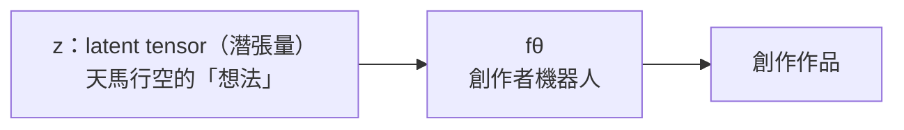
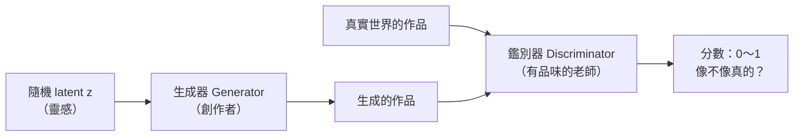
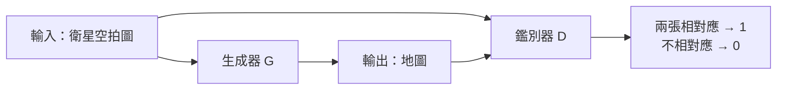
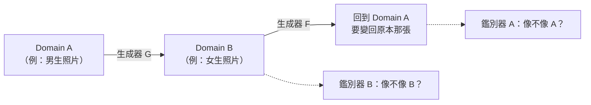

# 第 03 講｜AI 為什麼每次都不一樣？：GAN、Cross Entropy 與隨機性

> 課程：【TAICA_生成式AI：文字與圖像生成的原理與實務】（115 學年度上學期）
> 資料來源：投影片《03 AI 為什麼每次都不一樣？》（102 頁）＋ 上課錄影（YouTube：<https://www.youtube.com/watch?v=d7SJtimt3e0>，約 2 小時 54 分）
> 說明：本講義依投影片架構整理，並補上老師上課的口頭解說（標示為 💬 老師補充）。

---

## 本講重點總覽

| 單元 | 主題 | 一句話重點 |
|---|---|---|
| 01 | 創作型的 AI 很難做嗎？ | 「一對多」不是函數，硬訓練只會學到平均；解法是輸入一個隨機的 latent tensor（天馬行空的想法） |
| 02 | GAN 曾經是生成式 AI 的希望 | 訓練兩個呆萌型 AI 機器人互相對抗：生成器（創作者）vs. 鑑別器（有品味的老師） |
| 03 | GAN 的高光時刻 | Progressive GAN、StyleGAN（風格向量就像 prompt）、Pix2pix、CycleGAN（不用配對） |
| 04 | 學 AI 一定要弄懂的 Cross Entropy | 資訊量＝驚訝指數 −log p；分類問題的 Cross Entropy 就是 −log（正確答案的機率）；KL 散度＝CE − H(P) |
| 05 | 隨機性怎麼出來的呢？ | 同一個模型，「選最高分」就固定，「依機率抽」就每次不同——語言模型就是依 softmax 機率抽字 |
| — | 作業 | 設計你自己的呆萌型 AI 機器人：寫清楚 ① 輸入 ② 輸出 ③ 為什麼想要它，並畫一張 AI Canvas |

**最重要的觀念**：AI 每次都不一樣，是因為**隨機性**——GAN 的隨機性來自一開始抽出來的 latent vector；語言模型的隨機性來自「依 softmax 的機率抽下一個字」。所謂「鑑別式 AI」和「生成式 AI」，**原理上可以是同一種模型，只是用法不同**。另外，今天的數學式子大多是「拿出去嚇人用的」：看懂意思就好，作業不會考推導，但以後別人拿這些式子嚇你時，你不會被嚇到。

---

## 01. 創作型的 AI 很難做嗎？

### 1.1 先記得：現代 AI 就是設計「呆萌型 AI 機器人」

- 呆萌型 AI 機器人＝**函數學習機 fθ**：只要知道**輸入是什麼、輸出長什麼樣子**。

💬 老師補充：
- 「輸入跟輸出要很清楚地說出來」**幾乎是這門課最重要的一句話**。每一次都要很清楚說出你的 AI 模型到底在做什麼。
- 今天的作業就是請大家說出「你想打造哪一種呆萌型 AI 機器人」。不用講偉大的技術問題，**只要很清楚地說出輸入、輸出就好**。

### 1.2 創作型 AI 要輸入什麼、輸出什麼？

- 創作型 AI：輸入「不知道是什麼」，輸出是一個作品——寫歌機器人生一首歌、生圖機器人生一張圖、寫作機器人生一篇文章。
- 直覺的想法：輸入「一個可愛的女孩」，輸出一張可愛女孩的圖。
- 問題：**同樣的輸入有很多不同輸出的可能**（第一張、第二張、第三張……都符合需求）。

### 1.3 一對多不是函數

- 一對多**不是函數**。硬要訓練的話，同樣的輸入會學到**所有輸出的平均**。
- 平均之後很可能**四不像**；就算運氣好平均出來剛好可以接受，也**不是我們要的創作**。

💬 老師補充：
- 在還沒有大型語言模型的「簡單模型」時代，「一個可愛的女孩」其實就是「概念 1」、「飛機」是概念 2、「柯基犬」是概念 3……輸入只是 1、2、3 這樣的編號，輸出卻有很多張圖，所以是一對多。
- 硬訓練的結果：平均起來的圖可能連是不是一個人都不一定。
- 就算平均剛好是一個可愛的女孩，**每次輸入同樣的話，輸出都是同一張圖**——這就沒有創作能力。我們希望它每次都能創作出**不同的作品**。
- 為什麼大家很早（十多年前）就想讓 AI 有創作能力？
  1. 真的很希望 AI 會創作。
  2. 面子問題：圖靈很早就問過，能不能做出一台讓我們分辨不出是機器的對話機器。
  3. AI 科學家們認為，**能生成出來，才算電腦真正理解了這個東西**。

### 1.4 創作者機器人：輸入一個 latent tensor

- **Latent tensor** 是某個數據的特徵表現 tensor。它可以是「算得出來的表徵張量」，也可以是**隨機產生**的。
- 只要改變前面的 latent tensor，就會輸出不同的作品。

💬 老師補充：
- Tensor 我們已經學過：向量、矩陣、3D 矩陣等等「某一種結構的一串數字」都叫 tensor。
- 今天要做一件「很噁心」（很粗暴）的事：**latent tensor 直接隨機抽**，通常從**標準常態分佈**（平均值 0、標準差 1）抽出一堆數字，代表「現在要畫的圖的概念」。
- latent tensor 還有別的做法，之後的課會再介紹，看看那些做法有沒有比較厲害。

---

## 02. GAN 曾經是生成式 AI 的希望

### 2.1 LeCun：GAN 是深度學習最有潛力的 model

> There are many interesting recent development in deep learning… The most important one, in my opinion, is adversarial training (also called GAN for Generative Adversarial Networks).
> —Yann LeCun（楊立昆），2016

💬 老師補充：
- 如果早五年上 AI 課，只要講到生成式 AI，**一定要提 GAN（生成對抗網路）**。
- LeCun 是「深度學習三巨頭」之一，博士班時就在研究 **CNN**（很會做圖形辨識的神經網路），之前在 Meta（Facebook）擔任首席科學家，後來離開。
- 這段話剛好是十年前的事。「很少領域是十年前就要叫古典技術的，好可憐啊。」

### 2.2 作者 Ian Goodfellow

- GAN 原創者 **Ian Goodfellow**，之前最有名的是和他博士時期的兩位老師 **Yoshua Bengio**、**Aaron Courville** 合寫了號稱 **Deep Learning 聖經**的書。
- 論文：**Generative Adversarial Networks**（Goodfellow 等人，NIPS 2014），<https://arxiv.org/abs/1406.2661>
- 原創者親授：Ian Goodfellow 的 GAN 教學（NIPS 2016），<https://youtu.be/AJVyzd0rqdc>
- **The GAN Zoo**：曾經紅到人人都要做一個 GAN，<https://github.com/hindupuravinash/the-gan-zoo>

💬 老師補充：
- 那本《Deep Learning》出版時，市面上還沒什麼完整的深度學習教材，又是大師寫的，所以非常轟動，很多人入門都看這本，到現在也還是相當好的教材。
- 初代 GAN 生成的圖解析度很低：隱隱約約看得出右上角是一匹馬、右下角好像是一隻狗、飛機……但那時候大家**第一次看到 AI 真的能創造出它從來沒學過的圖**，所以非常興奮。「不得不給那時候的 AI 科學家一點掌聲，他們的想像力真的很豐富。」
- 2016 年那場教學影片裡有個有名的八卦：一位 AI 界很有名的人物（也是重要模型的作者）很喜歡在研討會上舉手說「你這個做得也算不錯啦，不過十年前我的學生就做過一樣的東西了」，那次他當場就說了。「大家對這個八卦的興趣可能會比對 GAN 還強烈。」
- GAN 紅的程度：那時候如果你宣稱自己做 AI 卻沒做過 GAN，人家不會覺得你是做 AI 的——在 AI 界大概就像現在 ChatGPT 這種等級的紅。

### 2.3 字型生成 GAN（老師團隊的作品）

- **Variational Grid Setting Network**（Yu-Neng Chuang、Zi-Yu Huang、Yen-Lung Tsai）
- 當年號稱「**大圖輸出**」：512 × 512。

💬 老師補充：
- 用 GAN 的手法，輸入一個字就可以轉換它的風格。例如很喜歡某套日文字型，但日文字型有很多中文缺字，就用 GAN 訓練它把缺的中文字補齊。
- 512 × 512 現在會照相的人一定覺得「這麼小也叫大圖？」但當時初代 GAN 大概只有 56 × 56 或 64 × 64，所以 512 × 512 在那個時代已經算大圖輸出了。

### 2.4 GAN 是怎麼做到的？訓練兩個神經網路！

- **生成器 G**：生成創作作品。
- **鑑別器 D**：判斷創作是否夠像真的。
- 兩個神經網路**相互對抗**，所以叫**生成對抗網路（GAN）**。

💬 老師補充：
- 一個呆萌型 AI 機器人不行，就訓練**兩個**：一個是創作者（生成器），一個是老師（鑑別器），老師要被訓練得「有品味」。
- 不一定是畫圖，音樂、文字都可以——你想創作什麼，就訓練它生成什麼。
- 生成器生圖其實沒有很神奇：例如要生 56 × 56 的彩色圖，只要讓它輸出**三張 56 × 56 的矩陣**（紅、綠、藍的強度）就是一張圖。不用教它任何畫圖技巧。一開始輸出看起來像雜訊，我們希望它越練越好。
- 那時大家也不知道該輸入什麼樣的 latent tensor 才合理，後來發現**隨機輸入就好**。馬後炮的解釋：從標準常態分佈隨便抽一堆數字，就像人類天馬行空的想法，每次抽的不一樣，想法就不一樣。

### 2.5 先訓練鑑別器的「品味」

| 輸入 | 正確答案（輸出） |
|---|---|
| 真實世界（符合我們標準）的作品 | 1 |
| 生成器的作品 | 0 |

💬 老師補充：
- 鑑別器其實**很容易準備訓練資料**（老師一開始口誤說「很容易訓練」，馬上更正）：
  - 正面教材：要生照片，就去 Google 搜尋很多同類型的真實照片；要創作音樂，就收集很多音樂。這些都標 1。
  - 反面教材：生成器亂生出來的東西，尤其是一開始那些爛爛的圖，都標 0——「這種圖就是生成器生出來要騙你的」。

### 2.6 再來訓練生成器

- 訓練生成器時，**鑑別器參數不動（評分標準固定）**。
- 生成器希望鑑別器輸出 **1**（希望老師肯定）。

💬 老師補充：
- 鑑別器不能一直調標準：「發現生成器生了這個，我來調一下，讓自己知道這個該給低分」——不行，太不公平了。
- 所以兩個神經網路是**輪流訓練**的：先讓鑑別器有一點品味，再訓練生成器；例如老師給 0.3 分，生成器就知道沒畫好，想辦法調整讓分數越來越接近 1；然後再交互訓練下去。
- **訓練技巧很多**：一開始生成器只會亂畫，鑑別器很容易分出真假，如果把鑑別器訓練得太有品味，生成器就「了無生趣」，學不起來。
- 💬 這是**比鐵拳教育還鐵拳的教育**：你去找有名的老師學畫，老師什麼都不教，只說「畫吧」。你交出去，老師覺得太爛就打你一巴掌，也不告訴你哪裡不好（透視比例不對？哪裡要加強？），你就回去再畫……大概打個一萬次之後，你終於學會畫圖了。「還好接受這種教育的是 AI。」

### 2.7 GAN 就是生成器、鑑別器大對抗

| 角色 | 看到真實作品 | 看到生成器的作品 |
|---|---|---|
| 鑑別器 D | 希望接近 1 | 希望接近 0 |
| 生成器 G | — | 希望接近 1 |

- 兩者在「生成器的作品」這一格的目標**完全相反**，所以叫「對抗」。

### 2.8 又來到 paper 嚇人時間：三種分布

| 符號 | 意義 |
|---|---|
| p_z | latent vector 的分布（通常就是標準常態分佈） |
| p_x = p_data | 真實世界的分布 |
| p_g = p_model | 我們呆萌 AI 生成器的分布 |

- 再來也沒什麼的：**x ∼ p_data**，意思就是「真實世界的一張照片」。

💬 老師補充：
- AI 世界很喜歡把生成的東西看成一個「機率分布」。寫「標準常態分佈」大家不會怕，所以都寫成 p_z。
- 真實世界的分布我們其實不知道長怎樣，也沒有真的要算出來，只是很抽象地說「它長這樣」。
- 為什麼不直接說「x 是一張真實的照片」？「因為這樣講話沒有水準。」寫成「x 是從 p_data 分布中抽樣出來的一個範例」，聽起來就很有水準。弄懂之後就知道：**這些都是拿來嚇別人的東西**。

### 2.9 插播：可愛的 log

1. **log 是遞增函數**：只在大於 0 的地方有定義，接近 0 時趨近負無窮大，然後一直往上升；log 1 = 0。
2. **log 把可怕的乘法變成可愛的加法**：log(a · b) = log(a) + log(b)（除法則變成減法）。

💬 老師補充：
- 看到數學式子就「自動關機」的同學不用太擔心。今天的目標是讓大家知道這些式子**是什麼意思**，以後出去不要被人家嚇到——「外面充滿壞人，很喜歡用數學式子嚇你」。
- 課程從頭到尾都**不要求你推導或背公式**，有一點概念就好。
- log 是「全世界上升速度最慢的函數」之一，不過這不關我們的事。
- 鑑別器的輸出可以用 **sigmoid** 控制在 0～1 之間（比 softmax 還簡單）；只有輸入負無限大時才會等於 0，所以幾乎碰不到 0，可以放心取 log。

### 2.10 關於 GAN 的 loss

**鑑別器 D 的角度**（兩者都越大越好）：

1. 𝔼_{x∼p_data}[log D(x)]：看到真實作品，D(x) 越接近 1 越好 → log D(x) 越大越好（最大是 0）。
2. 𝔼_{z∼p_z}[log(1 − D(G(z)))]：看到生成作品，D(G(z)) 越接近 0 越好 → 1 − D(G(z)) 越接近 1 → log 越大越好。

**生成器 G 的角度**：

- 希望 D(G(z)) 越接近 1 越好 → 第 2 項 𝔼_{z∼p_z}[log(1 − D(G(z)))] **越小越好**。

**合起來就是生成對抗**：

$$\min_G \max_D V(D, G) = \mathbb{E}_{x\sim p_{data}}[\log D(x)] + \mathbb{E}_{z\sim p_z}[\log(1 - D(G(z)))]$$

💬 老師補充：
- 同一個式子，**鑑別器希望越大越好、生成器希望越小越好**，方向完全相反，這就是「生成對抗網路」合起來寫時看起來很複雜的式子。
- 學生可能會問「那幹嘛取 log？D(x) 越大越好不就好了？」——沒錯，意思就是越大越好。
- 如果你想學會這一套，「出去外面嚇人很方便，是真的」。弄清楚之後會發現真的沒有很難。

### 2.11 學習過程

- 圖來自 Goodfellow 等人 GAN 的原始論文（2014）：
  - **一開始 G 被下馬威！** p_g 和 p_x 像兩座分開的山，鑑別器 D 很容易就把它們切開。
  - 生成器想得到老師肯定，就慢慢往 p_x（真實世界分布）靠攏。
  - **學成時，D 無法分辨哪個是真的！** p_g = p_x，此時鑑別器的輸出是 **1/2**（論文有數學證明）。

💬 老師補充：
- 學到最好時，**不是**鑑別器給生成器的作品 1 分，而是鑑別器**分不出來**——覺得好像是真的、又好像是假的，這才代表學成了。
- 這張圖也是「很容易拿出去炫耀 AI 技術」的東西。實際上維度很高，根本畫不出這種圖，只是概念上是這樣。不用為了看懂它先把統計、機率論學好。

### 2.12 令人拍案叫絕的 WGAN

- WGAN 把 GAN 真正**推上高峰**。
- 解決的問題之一：**Collapse（崩壞）**——「管他的，反正都生這張，我知道老師會接受！」

💬 老師補充：
- 一般神經網路的目標很一致：把 loss function 變最小就對了。但 GAN 的兩個神經網路**目標不一致、甚至相反**，所以很容易**不穩定**。WGAN 讓訓練變穩定。
- 崩壞（mode collapse）：生成器只要成功生出一張老師肯定的圖，就覺得「太好了，老師不會再打我巴掌了」，從此**永遠只生這張圖**。這當然不是我們要的，WGAN 很巧妙地解決了這個問題。這在很多 AI 領域都會發生。
- 現在 GAN 已經不是主流，但某些情況下我們還是會用 GAN 這樣的小技巧來調整 AI。

---

## 03. GAN 的高光時刻

### 3.1 Progressive GAN：從簡單學到精細

- StyleGAN 前傳：**Progressive GAN** 生成明星照片。
  - Karras、Aila、Laine、Lehtinen，NVIDIA 團隊（ICLR 2018），<https://arxiv.org/abs/1710.10196>
  - 論文：*Progressive Growing of GANs for Improved Quality, Stability, and Variation*
  - 當初用的是現在基本上沒人用的 Theano、Python 2，而且**只有單 GPU**。
- 原理：**直接生高解析度很難，直接生低解析度很容易**。
  - 生成器從 4 × 4 開始學，學會了再接 8 × 8、16 × 16……一路到 **1024 × 1024**。
- 成果：「這攏係假ㄟ啦」（1024 × 1024 明星照）。

💬 老師補充：
- 目標是生出像名人肖像那樣的照片：**不是真的有這個人**，但會生出這樣的照片。
- 1024 × 1024 若是相機解析度，會照相的人會吐血；但在當時的 AI 已經叫做「超大圖輸出」，而且生得很漂亮。就算用現在的眼光看也相當好，除非你很認真找，才可能看到一些瑕疵。所以大家一度覺得 GAN 就是未來要走的方向。

### 3.2 This X Does Not Exist

- <https://thisxdoesnotexist.com/>：AI 生出各種不同的 X！
- <https://thispersondoesnotexist.com/>：生成人臉，又比第一代強。

💬 老師補充：
- 這些網站基本上是用 **StyleGAN（尤其是第二代）** 做的。貓奴可以去看「這隻貓不存在」，進去就會一直幫你生貓。
- 跟現在的生成工具比，它**速度很快**：按一下 reload，馬上就生出新的一張。

### 3.3 StyleGAN：我是不是可以有點「控制」生成的東西？

**z′ = x + w**

| 符號 | 意義 |
|---|---|
| z′ | 新的 latent vector |
| x | content vector（內容向量，或天馬行空的創意） |
| w | style vector（風格向量） |

- 可以想像一個 latent vector 是內容向量「加上」風格向量（不一定真的是加，反正就是合起來）。

**StyleGAN 原版用「看來比較有學問的加法」**：

1. 先把輸入的 latent vector z（512 維）轉成 **w**（512 維）。
2. 對 w 做一次 **affine transformation**：Aw + b（A、b 都是學來的），得到 y = (y_s, y_b)。
3. 用 **AdaIN** 加進去：

$$\text{AdaIN}(x_i, y) = y_{s,i}\,\frac{x_i - \mu(x_i)}{\sigma(x_i)} + y_{b,i}$$

   - 對第 i 個 channel 做 normalization，再乘上 y_s、加上 y_b。
4. 生成器一樣從 4 × 4、8 × 8 學到 1024 × 1024，**每一層都用 AdaIN 加入風格向量 w**（另外也加入 noise）。

- **w 就像是 prompt**：不斷提醒 AI 該怎麼畫。
- 我們可以**變換提示**：內容用 z，風格換成 w₁ 或 w₂，就得到不同風格。

💬 老師補充：
- 這個想法影響了後來的生成式 AI。現在生圖時，我們都習慣描述想要的內容，例如「一個人坐在咖啡店裡用筆電」（「老師實在太沒想像力了」）。StyleGAN 那時就已經開始嘗試這件事，只是還沒辦法這麼精準地描述，**要等有了語言模型之後才比較做得到**。
- 最早的 GAN 只能隨機生一張漂亮照片，沒辦法控制「亞洲人或歐洲人」「金髮或黑髮」。後來發現**有些向量可以控制**，就想辦法把它們「混起來」。這在 AI 裡非常常見，基本上就是加起來，只是通常不用很單純的加法——一方面有原因，一方面「複雜的加法拿出去比較嚇人」。
- 哪個向量代表內容、哪個代表風格，其實是**我們自己定的**，訓練時想辦法讓它可以控制。
- AdaIN 看起來會讓人昏倒，其實紅框那部分就是**高中統計**的「標準化」：把數據變成平均 0、標準差 1 的標準常態分佈；再乘上想要的標準差（y_s）、加上想要的平均值（y_b），就變成新的常態分佈。y_s 控制標準差、y_b 控制平均值。沒有心理準備的話，可能會去背這個公式，背完也不知道為什麼長這樣。
- 好消息：AI 很多領域都是這樣，**一開始用複雜、高級的方法，最後發現最簡單的方法才是解方**。所以後面的課會越上越快樂。

### 3.4 Pix2pix：簡單畫畫就產生很真實的相片

- Isola、朱俊彦等人（CVPR 2017），*Image-to-Image Translation with Conditional Adversarial Networks*，<https://arxiv.org/abs/1611.07004>
- 例子：**衛星圖變地圖**、**隨手畫畫變街景**（可以用來**訓練自駕車**！）
- 關鍵：**輸入和輸出要同時送進鑑別器**。

💬 老師補充：
- 情境：用無人機拍空拍圖，希望自動畫出像 Google Map 的地圖；或素描一隻貓，右邊生出真實的貓。左邊是容易取得的資料，右邊是我們想要的樣子。
- 現在生成器的輸入**不再是隨機的**，而是一張衛星照片。
- 如果鑑別器只看地圖「像不像地圖」，就會發生**崩壞**：只要輸出是一張地圖，老師就說很好，但那不一定是對應原本空拍圖的地圖。所以要**兩張一起送進去**，右邊確實是左邊的地圖才是 1，沒關係就是 0。
- **為什麼要生成街景來訓練自駕車？**
  - 自駕車用的是**強化學習**：讓 AI 自己開車，撞到樹扣分、撞到人扣一千分，順利開回來加分，從錯誤中學習。強化學習在現在的大型語言模型裡也很重要，之後會好好介紹。
  - 但不能讓 AI 真的上路——「撞死一千個人才學會開車，那還得了」，還沒學成就被告慘了，所以需要**模擬場景**。
  - 為什麼不用 Google 街景車拍的畫面？因為一開始 AI 很弱，好好開著會突然右轉；Google 車不會突然右轉，所以**沒有右轉之後的畫面**。我們不知道 AI 會做什麼奇怪的選擇，所以需要能**即時生成街景**的技術：左邊像賽車遊戲那樣容易用程式畫出來，再轉成真實街景。
- 訓練資料要配對，但這還算簡單：從真實街景生成左邊那種簡單圖比較容易，所以可以準備很多配對資料。

### 3.5 CycleGAN：讓人驚呆的魔法

- 朱俊彦等人（ICCV 2017），*Unpaired Image-to-Image Translation using Cycle-Consistent Adversarial Networks*，<https://arxiv.org/abs/1703.10593>
- **資料「不需要」配對！** 於是有無限可能，例如「Cycle GAN 般的機器翻譯」。

- 例子：
  - **全世界都驚呆了的馬變斑馬**（<https://youtu.be/9reHvktowLY>）
  - CycleGAN 作者群**幽自己一默的失敗例子**
  - Goodfellow 也關注的**館長變陳沂**（魏澤人老師，<https://youtu.be/Fea4kZq0oFQ>）

💬 老師補充：
- 情境：放進自己的照片，生出「如果我是女生會長什麼樣子」（「聽起來好悲傷的感覺」）。用 Pix2pix 的方法要配對資料，就得全球去找一個長得很像你的女生，要找上萬組，幾乎不可能。
- CycleGAN 的做法是訓練**兩套 GAN**：
  - G：男生照片 → 女生照片，由鑑別器 B 判斷像不像女生。
  - F：女生照片 → 男生照片，由鑑別器 A 判斷像不像男生。
  - 只有這樣還不夠：G 可能每次都生出同一位女明星的照片，老師也會說可以，這樣沒用。
  - 關鍵是**繞一圈回來**：男生照片經過 G 變成女生，再經過 F 要**變回原本那張照片**，才算成功。
- 機器翻譯也因此跨入新時代：以前要手把手教「這句英文的中文是這個」。用 CycleGAN 的想法，英文進去出來像中文就好，中文再經過 F 要回到原本英文的意思才算成功——它就自己學會了兩種語言，而且我們幾乎沒有教它。
- 魏澤人老師（現在在陽明交大）做了「館長變陳沂」的 YouTube 影片，大家可以去看看快十年前的技術大概到什麼程度。

### 3.6 大家一度認為 GAN 是電腦創作的巔峰……

- ……直到出現 **diffusion models**。

💬 老師補充：
- GAN 不只做圖像，連翻譯都可以，所以大家一度以為生成式 AI 就該走 GAN 的路線。
- 但在圖像生成上碰到強勁對手 **Diffusion Model**；另外還有一個相對來說**更簡單**的模型，就是 ChatGPT 等**大型語言模型**。這些後面會介紹。
- 為什麼要花時間講十年前的技術？看看那時大家做了哪些辛苦的事、如何逐步有成果；之後學到現代一點的生成式 AI，就會發現「開始過著幸福快樂的日子」。
- 為什麼要講原理？只看科普介紹，很容易被帶到奇怪的地方：人家說的話不一定錯，但你不懂真正的意思，就會把概念用到錯誤的地方（本講第 05 單元就有一個例子）。
- 預告：**下下週介紹 Transformer** 時，會再一次看到很多矩陣乘來乘去的數學，「之後就再也沒有了」。所有作業都不會用到這些數學，但如果以後想深入了解 AI，人生中總會碰到一次，不如現在就先看看。

---

## 04. 學 AI 一定要弄懂的 Cross Entropy

### 4.1 前情摘要：八哥辨識

- 輸入一張八哥照片，輸出三個分數：**土八哥、白尾八哥、家八哥**。
- 最後經過 **softmax**，八哥辨識就可以看成**每次輸出一個機率分布**（加起來是 1）。
- 例如輸出 [0.6, 0.3, 0.1]，正確答案是 [1, 0, 0]，所以的確是「正確」的（土八哥最高分）。

💬 老師補充：
- 實際產品不會拿 0.6、0.3、0.1 去嚇使用者，會直接告訴他「這隻是土八哥」。

### 4.2 用均方差（MSE）計算 loss 的問題

| 模型答案 | 和正確答案 [1, 0, 0] 的差距 |
|---|---|
| [0.6, 0.3, 0.1] | (1 − 0.6)² + (0 − 0.3)² + (0 − 0.1)² = **0.26** |
| [0.6, 0.2, 0.2] | (1 − 0.6)² + (0 − 0.2)² + (0 − 0.2)² = **0.24** |

- 但這兩個答案都算正確，很多時候也「一樣好」（因為正確答案都是 60%）。有沒有算法能讓 loss 一樣呢？

💬 老師補充：
- 課堂上請大家投票哪個答案比較好，**選第二個的人比較多**——因為照 MSE 算，0.24 比較小。
- 但我們只要它選對土八哥，而且兩個都是 0.6，照理應該一樣好。
- 更進一步，用**專業眼光**看：土八哥和白尾八哥比較接近，家八哥差比較遠。第一個答案把前兩個拉得比較近、把家八哥推得比較遠，**反而比第二個好**。
- 平常我們不一定能做這種專業判斷，所以至少希望這兩個答案的 loss **一樣大**。

### 4.3 資訊量（驚訝指數）

- 發生一件事 x，如果機率 p 很低，我們會很驚訝；機率 p 很高，就一點也不驚訝。
- 用 **−log(p)** 表示剛好：機率越小，值越大；機率是 1 時，值是 0。
- 正式名稱是事件 x 的「**資訊量**」：

$$I(x) = -\log P(x)$$

- 例子：在幾乎不下雨的加州——
  - 「明天是晴天。」→ 這不是廢話嗎？**資訊量小**
  - 「明天下大雨！」→ 真假！？**資訊量大**

💬 老師補充：
- 機率越小，資訊量越大；機率越大，資訊量越小。要怎麼用數字表示其實隨你，但我們剛好有個可愛的函數 log：0～1 之間的數取 log 是負的，機率越小就負越大，**再加個負號就變成很大的數**。
- 政大天天下雨，說明天下雨不算驚訝（「不要這樣把自己污名化，晴天其實也不少」）。所以舉南加州的例子：老師在那裡唸書時真的很少下雨，一下雨記者就穿雨衣上街報導「天雨路滑、哪裡又發生車禍」，就像台灣在播颱風新聞一樣。

### 4.4 回到八哥：分類問題的 Cross Entropy

- 我們只在意**正確答案（土八哥）的得分**：土八哥得分越高，扣分越少；得分越低，我們就越「驚訝」。
- 正確答案 [1, 0, 0]、我們的答案 [0.6, 0.3, 0.1]，Cross Entropy 為：

$$-\log(\hat{y}_1)$$

- 換言之，**正確答案你還說機率很低，就給你大扣分！**

💬 老師補充：
- 正確答案的機率答得越接近 1，這個數字就越接近 0；明明是正確答案，你卻說機率只有 0.001，驚訝指數就很大，要大扣分。

### 4.5 Cross Entropy 到底 cross 在哪？Entropy 又是什麼？

- 其實就是比較**真實世界的機率分布 P** 和**神經網路學到的機率分布 Q**（Q 是我們用 softmax 硬弄出來的），希望越接近越好。
- Cross Entropy 也可以當 loss function，事實上**分類問題用它還更適合**。

**Entropy（熵、能趨疲）是資訊量的期望值（平均）**

假設機率分布 P = [p₁, p₂, ⋯, pₙ] 有 n 個事件：

$$H(P) = -\sum_{i=1}^{n} p_i \log p_i$$

- Entropy 是**平均資訊量**：越大表示可能的情況越複雜。只有一個事件、機率是 1 時，entropy 是 0。所以大家常說 entropy 是「**亂度**」。
- 寫成期望值會長這樣（「這看來也太可怕了！」）：H(X) = −𝔼_{x∼P}[log P(x)] = −∑ P(x) log P(x)
- 三個事件時：H(X) = −[p₁ log p₁ + p₂ log p₂ + p₃ log p₃]（Shannon Entropy）

**Cross Entropy**

真實分布 P = (y₁, y₂, y₃)、神經網路的答案 Q = (ŷ₁, ŷ₂, ŷ₃)：

$$H(P, Q) = -\sum_{i} y_i \log(\hat{y}_i) = -(y_1 \log \hat{y}_1 + y_2 \log \hat{y}_2 + y_3 \log \hat{y}_3)$$

- 正確答案通常是 [1, 0, 0] 這樣的 **one-hot encoding**。假設第 i 類是正確答案（yᵢ = 1），其他項都是 0：

$$H(P, Q) = -y_i \log \hat{y}_i = -\log \hat{y}_i$$

- **分類問題的 Cross Entropy 其實很簡單**：就是「正確答案那一類的資訊量」，跟 4.4 的直覺做法一模一樣。

💬 老師補充：
- 「cross」的意思：前面乘的機率是**真實世界的機率**，後面的資訊量卻是**我們呆萌型 AI 機器人吐出來的答案的資訊量**，兩個交叉在一起。
- 當答案不是 100、010、001 這種簡單分布時（後面蒸餾的例子），就需要一般化的 Cross Entropy。
- 再強調一次：作業沒有這種題目，不用擔心。

### 4.6 為什麼不用 MSE 呢？

複習：MSE 是高維度空間兩點距離的平方，L(θ) = (1/2k) ∑ ‖yᵢ − ŷᵢ‖²。

假設正確答案 y = [1, 0, 0]：

| 模型輸出 | MSE | Cross Entropy |
|---|---|---|
| [0.7, 0.19, 0.11] | 0.14 | 0.36 |
| [0.7, 0.3, 0] | 0.18 | 0.36 |

- Cross Entropy **單純在意正確答案**：只要正確答案都是 0.7，兩者的 loss 就一樣。

### 4.7 Cross Entropy 最小的時候 → KL 散度

- 當 Q = P 時，H(P, Q) 有最小值，也就是 P 的 entropy H(P)。
- **注意最小值不一定是 0！**
- 所以定義 **Kullback-Leibler Divergence（KL 散度）**：

$$D_{KL}(P \parallel Q) = H(P, Q) - H(P)$$

- 當 Q = P 時，**KL 散度為 0**！
- H(P) 是真實世界的 entropy，是固定的數值。所以 **Cross Entropy 越小，KL 散度也越小**。

💬 老師補充：
- 完全答對了，loss 卻不是 0、還要扣分，感覺很奇怪——「就像去考試，說你如果完全答對，我們就扣十分」。
- 解法很簡單：Cross Entropy **再減掉真正的 entropy**，模擬到剛好跟 P 一模一樣時就扣 0 分，這就是 KL divergence。
- 深入機器學習一定會聽到 KL divergence，甚至問 ChatGPT 時它會講得「一個比一個玄」，其實沒什麼玄的。

### 4.8 差異一樣，但差距的量級不同

假設正確答案 y = [0.7, 0.2, 0.1]：

| 模型輸出 | Cross Entropy | KL Divergence |
|---|---|---|
| [0.75, 0.15, 0.1] | 0.81 | 0.01 |
| [0.6, 0.3, 0.1] | 0.83 | 0.03 |

- Cross Entropy 看起來差不多（0.81 vs. 0.83），KL 散度卻差了 **3 倍**！KL 散度比較容易看出兩者差距的大小。

### 4.9 需要學 soft target 時，就該考慮 KL 散度：例如蒸餾

| | 學習目標 | 說明 |
|---|---|---|
| 一般學法 | **Hard Target**：[1, 0, 0] | 非常精準的標準答案，其實就是學生自己學 |
| 蒸餾 | **Soft Target**：老師模型的輸出，例如 [0.7, 0.25, 0.05] | 學生模型試著學老師的「思路」 |

💬 老師補充：
- 分類問題的答案通常是 100、010、001，似乎沒有 KL 散度出場的機會；但當答案是 0.7、0.2、0.1 這種機率分布時，KL 散度就很好用。
- **蒸餾（distillation）**：在語言模型很常聽到。不只是「敵對公司拿我們的模型去蒸餾」，我們自己也常做：先訓練一個超厲害的大模型，但大到大家都跑不動，於是訓練一個小模型（學生模型），希望有大模型（老師模型）八、九成的實力。
- 比喻：教科書白紙黑字寫在那裡，你很難懂；老師消化吸收之後再講一次，你就比較容易理解。
- 再厲害的老師模型看到土八哥也不會直接說 [1, 0, 0]，可能說 [0.7, 0.25, 0.05]——它看出這隻有點像白尾八哥、很不像家八哥。學生去學**老師的答案而不是正確答案**，就是學到老師消化吸收後的結果，不用從頭學起。
- 現在看到很多語言模型在「蒸餾人家的」，其實就是想辦法從老師模型身上學過來。

---

## 05. 隨機性怎麼出來的呢？

### 5.1 在 GAN 裡，是一開始就隨機

- GAN 的隨機性來自**一開始隨機抽出來的 latent z**——隨機抽天馬行空的想法！

💬 老師補充：
- 創作一定需要一點隨機性：畫山水畫，不希望下完 prompt 後每次畫出來都一模一樣。
- 文字生成看起來好像不是 GAN 那種做法，但其實用的是**同樣的概念**。

### 5.2 回到八哥辨識：選最高分 vs. 依機率抽

| 做法 | 結果 |
|---|---|
| 選最高分 | 同樣的輸入，永遠是同樣的輸出（土八哥） |
| 依機率抽 | 60% 抽到土八哥、30% 抽到白尾八哥、10% 抽到家八哥 |

💬 老師補充：
- 明明學會了，土八哥進來卻告訴人家是白尾八哥，聽起來怪怪的。但可不可以這樣做？「當然可以啊，你高興啊。」雖然很怪，但可以。

### 5.3 換了題目，依機率抽就有道理：咖啡推薦 AI

| 輸出 | 機率 |
|---|---|
| 衣索比亞日曬 | 0.6 |
| 瓜地馬拉水洗 | 0.3 |
| 哥斯大黎加蜜處理 | 0.1 |

- 客人化為神秘的輸入。如果是咖啡推薦 AI，依機率抽可能就比較有道理。

💬 老師補充：
- 假設咖啡店永遠只有三種咖啡（「政大藝文中心的咖啡店其實只有一種咖啡，就不能做這種模型」）。假設你相信**面相**會決定客人喜歡的咖啡：每個客人進來就拍照，記下他點了哪一種，累積成訓練資料。
- 模型不會百分之百準，客人每天來也可能想要一點變化，所以**依機率抽**很合理：大部分時候會抽到他最可能喜歡的那種，偶爾換換口味。
- 重點：**這兩種用法是同一個模型**，只是用法不一樣。

### 5.4 我們的主角語言模型，就是用機率抽字

- 它在做的事其實只有一件：**看前面的一堆字，猜下一個字**。
- 例如「呆一布在 ___」：家 15%、桌 7%、玩 12%、裝 3%……這些機率是 **softmax** 來的。

💬 老師補充：
- 語言模型做完 softmax 得到機率分布後，就從裡面抽一個字出來。
- 所以用 ChatGPT 時，覺得它答得不好、請它重新生成，它會換一個說法。如果都選最高分，「搞什麼，每次跟它講答得不好，它居然重新答一樣的答案」。
- 它的做法基本上跟八哥辨識一樣，是**某種分類模型**。

### 5.5 「AI 有兩種」？原理上是一樣的

- 很多人喜歡說 AI 有兩種：**鑑別式 AI（Discriminative AI）** 和 **生成式 AI（Generative AI）**。
- 這些「背資料學 AI」的人會說：「生成式 AI 有幻覺，所以有時我們要用鑑別式 AI。」
- **可是，原理上它們是一樣的啊……**

💬 老師補充：
- 老師聽過太多次了，常常在 AI 演講開場就這樣說：鑑別式 AI 像八哥辨識，生成式 AI 像大型語言模型——但它們**可能明明就是長一樣的模型**，只是用法不同。
- 這就是為什麼要懂原理：不懂原理的話，有些話自己說起來覺得很有道理，其實是錯的。

---

## 【作業】你想打造哪一個呆萌型 AI 機器人呢？

### 任務：設計你自己的呆一布！

- 想一個你**真心想要**的 AI 機器人，越貼近生活越好。
- 需要寫下：
  1. 它的**輸入**是什麼
  2. **輸出**是什麼
  3. 你**為什麼想要它**

### AI Canvas

| 區塊 | 欄位 | 要寫什麼 |
|---|---|---|
| 領域專家的期望 | **問題** | 我想解決什麼問題 |
| | **能力** | 我需要 AI 有這樣的能力 |
| | **判斷** | 為什麼 AI 有了這樣的能力，可以幫我解決問題 |
| AI 的任務 | **輸入** | 輸入是什麼，需要寫出所有的 features |
| | **輸出** | 輸出是什麼，記得一定要是一個 **tensor** |
| | **數據** | 足夠的數據容易找嗎？大概可以有多少筆訓練資料 |

💬 老師補充：
- **不用真的做出來**（老師強調了好幾次），但要很清楚輸入、輸出是什麼。
- 請不要想**無聊的機器人**，也不要想**可以直接算出答案的**：例如輸入兩個數字、輸出它們的和——直接寫程式算就好。
- AI Canvas 是老師和政大另一位老師（錄音聽起來是陳宜秀老師）合開的課程中使用的工具。上半部（問題、能力、判斷）是**領域專家才知道的事**；下半部才是平常說的 AI 世界。
- 「問題」和「能力」有什麼不同？以**拍一張照就知道這餐營養成分**為例：
  - 問題：想知道這餐的營養成分夠不夠。
  - 但直接「輸入照片、輸出營養成分」很難設計，因為營養成分每次可能是 3 種、8 種、20 種，**輸出的個數不固定**。
  - 能力：讓 AI **辨識照片裡是什麼食物**（技術上要先把每種食物切開，叫 segmentation）。
  - 判斷：知道吃了什麼，再用另一個 AI 估算份量，就能算出營養成分，知道吃得夠不夠、缺了什麼。
- **評分方式**：
  - 輸入、輸出只要模稜兩可或寫不清楚，**最高就是 2 分**（「也許別的老師說交了就給 6 分，在我們這裡輸入輸出講不清楚就是 2 分」）。
  - 問題很無聊但輸入輸出講得清楚，會高於 2 分，但不會很高。請想一些**有趣、最好是我們從來沒想過的問題**。
- **數據要好找**：AI 一定要大量訓練資料。花錢買得到的，可以假設是好找的。
  - 反例：高中生常想用「整學期的讀書時間」預測學測數 A 成績——很有道理，但每一筆資料都要一位同學真的記錄一整年的讀書時間，**訓練資料很難找**。

---

## 💬 閃電秀（影片約 1:51～2:16）

- 今天報名閃電秀的同學都是**校外同學**，透過 Google Meet 連線報告。
- 現場設備出現**回音（echo）**問題，線上聲音無法正常播出。第一位同學的作品以影片播放，內容是用**極座標玫瑰線**畫花瓣、中間放一條**參數式愛心**（x = 16 sin³t），再調整大小比例讓愛心和玫瑰協調。
- 因為一直無法排除問題，其餘兩位同學**順延**，由助教另行聯繫；也鼓勵大家繼續踴躍報名閃電秀。

> 這一段逐字稿因為回音，轉錄有大量重複句，參考價值較低。

---

## 💬 助教時間：作業二的 Colab 實作提醒（影片約 2:16～2:53）

### 打開範例與存檔

- 打開別人的 Colab（例如從 GitHub 上的 Open in Colab）時，左上角如果是 **GitHub 的章魚貓圖示**，代表檔案**不是你的**。
- 一定要按「**在雲端硬碟中儲存副本**」，變成 **Google Drive 的三角形圖示**，才是你自己的檔案。
- 檔名會變成「……的副本」，**一定要改掉**：改成學號、系級、姓名、第幾次作業等可辨識的名稱，方便助教，也方便自己。

### 要改成「你自己的作業」

- 老師的範例同時是**教學示範**，裡面有很多說明、解釋、插圖。看懂之後，不需要的就刪掉；真的重要的可以保留。
  - 例如「讀入一些套件，不理會這些細節」這種句子，原則上不該出現在你的作業裡。
- 建議至少**保留大標題**，讓自己知道這一段在做什麼；可以用 Markdown 補上自己的筆記和註解。
- **打開來看起來像老師範本的作業，助教很快就會判定分數不會高，甚至很低。**
- **重點截圖**：例如老師範例是 **3 層、每層 20 個神經元**，你做了 5 層，就要把層數、每層神經元數、加神經元的程式碼明確標示出來。
- 可以變化的地方不少：例如老師 demo 的 loss function 用 **MSE**，可以參考老師的建議或問語言模型、看其他教學網頁，換成別的方法並**比較結果**——這就是你作業的重點和特色。
- 自己新開的筆記本，課程要求的**固定四行套件，再加上 pandas**。

### Colab 的特性：快速看變數內容

- Colab 是**環境**，Python 是**語言**，兩者是分開的；有些效果是 Colab 環境才有的。
- 每個儲存格會**自動顯示最後一行的值**：
  - `A = 5`、`B = 10`、最後一行 `A + B` → 顯示 15。
  - 再多加一行 `A` → 顯示 5（因為最後一行是 A）。
- `print` 則會把所有被要求印出的內容都印出來。
- 用這個特性就能**拆解程式、檢查資料**：
  - `x_train[0]` 直接顯示時，Colab 偵測到影像格式可能直接秀出圖；用 `print` 才會看到 **28 × 28 的數值**（沒有筆跡的地方是 0，越黑越接近 255）。
  - 訓練資料共 **6 萬筆**，編號從 0 開始（第 13323 號其實是第 13324 筆）。範例中有**滑桿互動介面**，可以拉到某一筆看圖和對應的答案。
  - 上週的模型辨識正確率大約九成三、九成四，所以還是有 6～7% 的機會辨識錯。
- **reshape 前後對照**：`x_train = x_train.reshape(...)` 會直接覆蓋原本的變數。執行前印出來，有 28 組中括號；reshape 後只剩**一層中括號**，所有數字串成一個很長的一維向量——這就是範例說的「**拉平**」。
- `to_categorical` 也可以前後印出來，對照 **one-hot encoding** 變成什麼樣子。

### 亂數種子、summary 與重複執行的陷阱

- **亂數種子（random seed）**：想比較不同方法時，要固定亂數，否則每次隨機抽的東西不一樣，無法公平比較。設定亂數種子的那一行（TensorFlow / Keras 的設定函式）**一定要加在 `model = Sequential()` 之前**。
- **用 `model.summary()` 確認最終模型結構**：
  - 每加一層都可以看一次 summary，但最重要的是**最後要確認**模型長得是不是你要的。
  - 常見錯誤：想從 3 層改成 5 層，結果把新的一層加在 **softmax 輸出層後面**，變成「10 個神經元之後又接 20 個」，那就不是你要的網路。
  - **同一行 `model.add(Dense(...))` 多執行一次，就會多加一層。**
  - 亂掉了沒關係，從 `model = Sequential()` **從頭依正確順序再執行一次**；必要時用「**中斷並刪除執行階段**」把記憶體全部清掉。
- **重複執行訓練會累積**：就像 `A = A + 1` 重複執行，A 會變 1、2、3……
  - 已經訓練 10 次後，把 10 改成 20 再執行，其實是**總共訓練 30 次**。
  - 想比較時：可以分別建 `model1`、`model2` 各自訓練；或者每次都從 `model = Sequential()` 重新開始。
  - 過去就有同學不小心多執行，助教重跑時結果差很多，產生誤會。

---

## 名詞對照表

| 名詞 | 說明 |
|---|---|
| 呆萌型 AI 機器人 / 函數學習機 fθ | 只要說清楚輸入、輸出，讓神經網路去學這個函數 |
| 一對多 | 同一個輸入有很多正確輸出；不是函數，硬訓練會學到平均 |
| Latent tensor / latent vector（潛張量／潛向量） | 輸入創作型 AI 的「天馬行空的想法」；GAN 中通常從標準常態分佈隨機抽 |
| GAN（Generative Adversarial Network，生成對抗網路） | 生成器與鑑別器互相對抗、輪流訓練的生成模型 |
| 生成器（Generator, G） | 創作者，希望作品得到鑑別器肯定（輸出接近 1） |
| 鑑別器（Discriminator, D） | 有品味的老師，判斷作品是真實的（1）還是生成的（0） |
| p_z、p_data（p_x）、p_g（p_model） | latent vector 的分布、真實世界的分布、生成器的分布 |
| x ∼ p_data | 「x 是從真實世界抽樣出來的一張照片」的嚇人寫法 |
| sigmoid | 把輸出壓到 0～1 之間的函數（鑑別器輸出用） |
| min_G max_D V(D, G) | GAN 的目標函數：鑑別器要它越大越好、生成器要它越小越好 |
| Mode collapse（崩壞） | 生成器發現某張圖能過關，就永遠只生這張 |
| WGAN | 讓 GAN 訓練穩定、解決崩壞問題的改良版 |
| Progressive GAN | NVIDIA 提出，從 4 × 4 逐步學到 1024 × 1024 |
| StyleGAN | 把 latent z 轉成風格向量 w，透過 AdaIN 在每一層加入，可控制風格 |
| Affine transformation（仿射變換） | Aw + b，把 w 變成 (y_s, y_b) |
| AdaIN（Adaptive Instance Normalization） | 先標準化再乘上 y_s、加上 y_b，就是高中統計的常態分佈轉換 |
| Pix2pix | 條件式 GAN，輸入與輸出要一起送進鑑別器；需要配對資料 |
| CycleGAN | 兩套 GAN 繞一圈要回到原圖；資料不需要配對 |
| 強化學習（Reinforcement Learning） | 讓 AI 自己嘗試、依獎懲從錯誤中學習（自駕車、LLM 都會用到） |
| Diffusion model（擴散模型） | 後來在圖像生成上取代 GAN 的模型（之後介紹） |
| softmax | 把輸出變成加總為 1 的機率分布 |
| MSE（均方差） | 答案與正確答案差的平方和（平均）；不只在意正確答案 |
| 資訊量／驚訝指數 I(x) = −log P(x) | 機率越小的事件，資訊量越大 |
| Entropy（熵、亂度）H(P) | 資訊量的期望值（平均資訊量） |
| Cross Entropy（交叉熵）H(P, Q) | −∑ yᵢ log ŷᵢ；分類問題就是 −log（正確類別的機率） |
| One-hot encoding | 正確答案寫成 [1, 0, 0] 這種形式 |
| KL Divergence（KL 散度）D_KL(P‖Q) | H(P, Q) − H(P)；Q = P 時為 0 |
| Hard target / Soft target | 標準答案 [1, 0, 0] ／老師模型輸出的機率分布 |
| 蒸餾（Distillation） | 小的學生模型學大的老師模型的輸出（soft target） |
| 鑑別式 AI / 生成式 AI | 常見的分類說法；但原理上可以是同一種模型，只是用法不同 |
| AI Canvas | 規劃 AI 專案的表格：問題、能力、判斷（領域專家的期望）＋輸入、輸出、數據（AI 的任務） |
| Segmentation（分割） | 把影像中不同物體（例如每種食物）切開 |
| Random seed（亂數種子） | 固定亂數，讓不同方法的比較公平 |
| `model.summary()` | 印出 Keras 模型的層數與參數，確認結構 |
| `reshape` / 拉平 | 把 28 × 28 的矩陣變成一維向量 |

---

## 自我檢核

1. 為什麼「輸入『一個可愛的女孩』、輸出一張圖」這樣訓練創作型 AI 行不通？訓練出來會怎樣？
2. latent tensor 在創作型 AI 中扮演什麼角色？GAN 裡它通常怎麼產生？
3. GAN 的生成器和鑑別器各自的目標是什麼？為什麼訓練生成器時要固定鑑別器的參數？
4. 鑑別器的訓練資料怎麼準備？哪些標 1、哪些標 0？
5. 老師為什麼說 GAN 的訓練是「比鐵拳教育還鐵拳」？如果一開始把鑑別器訓練得太好，會發生什麼事？
6. 用白話解釋 min_G max_D V(D, G)：為什麼鑑別器希望它越大、生成器希望它越小？
7. GAN 學成時，鑑別器的輸出會是多少？為什麼不是 1？
8. 什麼是 mode collapse（崩壞）？Pix2pix 為什麼要把輸入和輸出一起送進鑑別器？
9. Progressive GAN 的核心想法是什麼？
10. StyleGAN 的風格向量 w 為什麼「就像是 prompt」？AdaIN 其實在做哪一件高中統計就學過的事？
11. Pix2pix 和 CycleGAN 最大的差別是什麼？CycleGAN 怎麼在不配對的情況下確保輸出和輸入有關係？
12. 為什麼訓練自駕車需要「生成街景」，而不能只用 Google 街景車拍的畫面？
13. 正確答案 [1, 0, 0]，模型輸出 [0.6, 0.3, 0.1] 與 [0.6, 0.2, 0.2]，用 MSE 和 Cross Entropy 計算各有什麼結果？你覺得哪個比較合理？
14. 為什麼用 −log(p) 表示資訊量（驚訝指數）很合適？舉一個「資訊量大」的例子。
15. Entropy 和 Cross Entropy 的定義各是什麼？分類問題的 Cross Entropy 為什麼可以化簡成 −log ŷᵢ？
16. Cross Entropy 的最小值是多少？KL 散度和 Cross Entropy 有什麼關係？為什麼需要 KL 散度？
17. 蒸餾時學生模型學的是 hard target 還是 soft target？這樣有什麼好處？
18. 同一個八哥辨識模型，怎麼讓它「每次都一樣」或「每次都不一樣」？語言模型的隨機性從哪裡來？
19. 「生成式 AI 有幻覺，所以要用鑑別式 AI」這句話有什麼問題？
20. 用 AI Canvas 規劃一個你想要的呆萌型 AI 機器人：寫出問題、能力、判斷、輸入、輸出、數據。為什麼「輸入照片、輸出營養成分」不是好的設計？
21. 在 Colab 上，同一行訓練程式重複執行會發生什麼事？要比較不同設定時，應該怎麼做？
