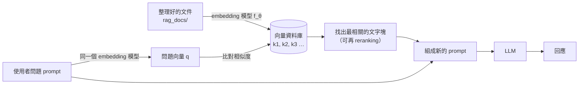

# 第 07 講｜讓 AI 看懂你的世界：RAG、記憶與 LLM Wiki

> 課程：【TAICA_生成式AI：文字與圖像生成的原理與實務】（115 學年度上學期）
> 資料來源：投影片《07 讓 AI 看懂你的世界》（52 頁）＋ 上課錄影（YouTube：<https://www.youtube.com/live/jSNrM7hjhek>，約 2 小時 53 分）
> 說明：本講義依投影片架構整理，並補上老師上課的口頭解說（標示為 💬 老師補充）。

---

## 本講重點總覽

| 單元 | 主題 | 一句話重點 |
|---|---|---|
| 01 | RAG 檢索增強生成 | 讓電腦**自動找出正確資訊**塞進 prompt，再請 LLM 回答 |
| 02 | 記憶的一種方式 | 「長期記憶」其實就是把過去對話做成向量資料庫，用 RAG 撈回來 |
| 03 | LLM Wiki | Karpathy 的個人知識庫：讓 LLM 把原始資料整理成人看得懂的 `.md` wiki |
| 04 | 作業 | 用自己的資料建向量資料庫（RAG01），再做出 RAG 對話機器人（RAG02） |

**最重要的觀念**：RAG 沒有什麼神奇的地方。它只是 prompt 兩大核心中的「提供正確資訊」，從**人工貼上**變成**讓電腦自動找**。懂原理，才知道它的限制在哪裡，不會被大名詞唬住。

---

## 01. RAG：一個降低錯誤的方法

### 1.1 RAG 是什麼

- **RAG = Retrieval-Augmented Generation，檢索增強生成**
- 外界常說 RAG 是「降低幻覺」的方法，但老師強調應該說是**降低錯誤**的方法。
  - 💬 老師補充：「幻覺」本來就是大型語言模型的特色。我們就是把它訓練成很會「接話」的模型，說要降低它的唬爛能力很奇怪。真正的目標是讓它**依照我們給的資料**回答，減少答錯。
- 再次強調：**理解原理，不要被大字彙迷惑。**

💬 **為什麼需要 RAG？舉例：查學校請假規定**

- 直接問語言模型，它可能上網找到**錯誤**或**過時**的資料（例如規定剛修改，它沒找到最新版）。
- 我們希望它：「麻煩你**依照我給你的資料**回答。」

💬 **為什麼一定要懂 RAG？**
- 不知道 RAG，沒人相信你學過生成式 AI。未來老闆很可能會問「我們是不是該做 RAG？」
- 但外面常把 RAG 講得好像「一做 RAG 就不會出錯」，**沒有這樣的事**。懂原理才知道它有限制。

### 1.2 RAG 引發非常多的討論（投影片 P4）

各種新聞與商業文章都在談 RAG，例如：〈RAG：讓 AI 更聰明的秘密武器〉、〈要當生成式 AI 新創，RAG 就是最佳舞台〉、〈避免 AI 幻覺 RAG 漸興起〉、〈RAG 是什麼？就像大型語言模型的「小抄」〉等。RAG 早已不只是技術名詞，也是商業熱門詞。

💬 老師補充（業界觀察）：
- 各行各業都要導入 AI，**領域專家**才知道真正要解決什麼問題；單純的 AI 工程師容易做出「正確率很高、但實務上沒幫助」的東西。
- 不論你是哪個領域，都需要懂 AI；而 AI 工程師也要靠近應用領域，**能跟人溝通**是業界最看重的能力之一。

### 1.3 其實就是 Context Engineering

回到 prompt 的**兩大核心概念**：

| 核心 | 說明 |
|---|---|
| ① **正確的資訊** | 提供 AI 回答所需的正確資料 |
| ② **清楚的指引** | 例如：用上面的資訊、以什麼格式與風格回答使用者的問題 |

- 今天專注在 ①「正確的資訊」怎麼給。
- 投影片提問：**「可以自己放，但不能叫電腦找嗎？」**→ 這就是 RAG。

💬 老師舉例：學校生輔組老師最清楚請假規定。學生在線上問問題，老師找出對應條文貼給 AI，AI 再根據條文回答——這樣可以，但「都要讓 AI 回答了，還放一個人在那邊找條文」很蠢。RAG 就是**讓電腦幫我們找條文**。

> RAG 是 Context Engineering 中一個很重要的技巧。

---

### 1.4 關鍵元件：Embedding 模型

**Embedding（嵌入）模型**：輸入一段文字 → 輸出**某個維度的向量**。

- 這個向量是這段文字的**特徵代表向量**，代表的是**抽象的意涵**（人看不懂）。
- 向量維度是我們自己訂的，例如每段文字都用 512 個數字（512 維）表示。
- Embedding 模型**基本上就是一個語言模型**。

💬 **它是怎麼訓練出來的？**

1. **代理任務**：我們真正要的是「代表文字意思的向量」，但沒人知道正確答案該是什麼向量，很難找訓練資料。所以改訓練一個「必須真的懂文字意思才能完成」的任務（例如：預測下一個字、用旁邊的字預測中間的字），再把**中間某個隱藏層**拿出來當作文字的代表向量。
2. **為何不直接用大型語言模型？** 可以，但太大了，「殺雞用牛刀」。實務上通常**另外訓練一個專門的 embedding 模型**。

#### 對比學習（Contrastive Learning）

| 符號 | 範例 | 目標 |
|---|---|---|
| 問題 *q* | 圖書館星期日幾點關門？ | — |
| 正例 *k⁺* | 本館週日開放至下午五點。 | sim(*q*, *k⁺*) **越近越好** |
| 負例 *k⁻* | 本館借書期限為三十天。 | sim(*q*, *k⁻*) **越遠越好** |

- 跟問題**有關**的內容 → 向量**拉近**；**無關**的 → **推遠**。
- 這樣能讓 embedding 學得更快、更符合「搜尋」需求。

**寫成數學式：**

$$
\mathcal{L}(\theta) = -\log \frac{e^{\mathrm{sim}(q,k^+)}}{\sum_{k} e^{\mathrm{sim}(q,k)}}
$$

💬 老師補充：看起來很可怕，其實是**老朋友**：
- 分母、分子的指數函數 → 就是 **Softmax**（把可能小於 0 的分數轉成正數）。
- 前面的 −log → 就是 **Cross Entropy**。
- 所以這其實就是一個**分類問題**：讓正確答案（*k⁺*）拿到最高分。

#### 區分「問題」和「內容」：prefix

```
query:   圖書館星期日幾點關門？
passage: 本館週日開放至下午五點。
```

- 💬 為什麼要區分？**內容通常很長、問題通常很短**。內容裡可能還有申請資格、年齡限制等一大堆資訊，真正能回答問題的那一句會被**稀釋**，導致找不到。
- 有些模型會在訓練與使用時加上前綴詞（prefix），告訴模型「這是問題」或「這是內容」。
- ⚠️ **這種 prefix 沒有通用寫法**，有些模型完全沒有使用。（不像 LLM 的 `user` / `assistant` 角色，因為 OpenAI 先用、大家沿用而成為慣例。）

---

### 1.5 準備資料：把文件切成「文字塊」

#### 做法一：最傳統（無腦）做法

1. 把所有檔案丟進一個資料夾（例如 `uploaded_docs/`），`.txt`、`.pdf`、`.docx` 都可以。
2. 程式自動切成一個一個**文字塊（chunk）**，例如每 **500 字**一塊、前後**重疊 50 字**。

需要考量：

| 考量 | 說明 |
|---|---|
| **文字塊大小** | 太小：一段話還沒說完就被切斷，語意不完整。<br>太大：重點被**稀釋**，例如 1000 字裡只有一小段相關，可能搜不到。 |
| **怎麼切** | 例如法條，是否要**一條一條切**？ |
| **重疊多少字** | 避免剛好切在不該斷句的地方，讓前後兩塊都看不到完整的那句話。 |

💬 老師說：這是去年課程為了簡化而教的做法，今年「不應該再欺騙大家了」，實務上已經比較少這樣做。

#### 做法二：比較新的做法——自己切成想要的樣子 ✅（推薦）

一個檔案＝一個概念＝一個文字塊。範例（勞動部「部分工時的定義」）：

```
標題：部分工時的定義                              ← 做 embedding
資料類型：官方資訊的教學改寫摘要（非網站全文、非法律意見）  ┐
主管機關：中華民國勞動部                            │ metadata
來源網址：https://www.mol.gov.tw/...               │
教材整理日期：2026-10-18                            ┘
【內容】                                            ← 做 embedding
部分工時，是指約定工作時間較事業單位全時勞工明顯縮短的工作安排……
【檢索練習問題】我只是週末工讀生，還有勞基法保障嗎？   ← 非必要
【提醒】這是為 RAG 教學重寫的簡短摘要……             ← 非必要
```

- 實際上分成**兩個部分**：
  1. **真的要做 RAG（Embedding）的文字**：例如「標題＋內容」。
  2. **Metadata**：不做向量化，只是像資料庫一樣記起來，可以做**關鍵字搜尋**或篩選。
- 內容不一定要是原文，也可以是**改寫後的意思**，看你的需求。

💬 **為什麼推薦做法二？**
1. 自動「每 500 字切一段」可能切壞，需要語意連貫的地方沒有連起來。
2. PDF、Word 等格式，**無法 100% 保證 AI 讀對**（尤其 PDF）。最好先用任何方法把文字讀出來、**確認文字正確**，再切成文件 1、文件 2、文件 3……

💬 **這種苦工交給誰？交給生成式 AI！**
- 跟 AI 討論：「我要做 RAG，資料在這裡，請幫我切成一個一個文字檔，每個檔案就是要做 RAG 的一塊，最後把資料夾**壓縮成 zip 檔**給我。」下載解壓後就是整理好的文件。
- 例如：把相機說明書整理成「調光圈的方法」「調快門的方法」……一個主題一個檔案。
- 當然也可以自己手工整理，只是作業時間會多很多。

#### Metadata：文字塊的附加資訊

- 例如：來源（原文）、所在頁數、文章標題、作者、日期、分類……
- **要存哪些 metadata，完全由你決定**，這也是做 RAG 的重要設計。
- **哪些東西不適合做 embedding？** 網址、資料類型這類資訊，壓成語意向量沒有意義。

**需要 Metadata 的例子（投影片 P16）：**
> 「我想知道什麼是 AI Agents，但不用管炎龍老師怎麼說，因為他都亂講。」

💬 語意搜尋只看「老師」「教課」等概念，可能撈出一堆不相干的老師；要找「特定的人」時，用**名字做關鍵字搜尋**（像傳統 Google）或用 metadata 篩選才準。

---

### 1.6 RAG 的完整流程



**步驟拆解：**

1. **建立向量資料庫**：把整理好的文件放進資料夾（如 `rag_docs/`），每份文件經 embedding 模型 *f*θ 變成代表向量 *k*₁、*k*₂、*k*₃……（每份重要資料都找到自己的特徵代表向量）。
2. **問題向量化**：使用者下 prompt 時，問題也經過**同一個** embedding 模型變成向量 *q*。
3. **比對**：看 *q* 跟哪些 *k* 最接近 → 取出和原本問題最接近、最相關的資料。**這也是近來 AI 搜尋的方法！**
4. **處理檢索結果**（見 1.7）。
5. **組 prompt 交給 LLM**（見 1.8）。

---

### 1.7 檢索結果的處理

💬 可能發生的狀況：

| 狀況 | 處理 |
|---|---|
| **找不到**：所有分數都沒到門檻 | 要有例外處理（例如回答「查無資料」） |
| **找太多**（較常見） | 取相似度前幾名（Top-k）、用 metadata 篩選、或重新排序 |

#### Reranking（重新排序）
- 找出的資料通常不只一筆，排序不一定照相似度分數。
- 例如 100 筆裡先找出 5 筆，再用**語言模型**逐一判斷「這段能不能回答問題」，重新排序。用什麼技術都可以，合理就好。
- 簡單做法：直接把**前三名**都丟給 LLM，讓它自己判斷哪段有用。最能回答問題的那段可能其實是第三名，但沒關係，LLM 看得出來。

#### 需要加入上下文或相關文章嗎？
1. 加入找到的文字塊的**前一塊、後一塊**（例如法條需要參考上下條才完整）
2. 加入**整篇文章**
3. 加入預先設定好的**相關文章**（文章之間連成圖狀結構 → 這就是所謂的 **Graph RAG**）

💬 老師提醒：
- 這些細節**本來就是坐下來想就會考慮到的常識**，懂原理就不怕。
- **千萬不要盲目使用自動化工具**：很多人以為自己做了 RAG，其實不知道工具怎麼切文字塊、做了什麼事。就算用自動化工具，也要知道它幫你做了什麼。

---

### 1.8 組成新的 prompt

基本上會有兩種資訊：

| 變數 | 內容 |
|---|---|
| `question` | 使用者的問題（原始 prompt） |
| `retrieved_chunks` | 用 RAG 找到的資訊 |

接著設計新的 prompt，例如：

```text
請根據 {retrieved_chunks} 裡的資訊，來回應使用者的問題：{question}
```

💬 老師補充：
- 這完全對應 prompt 兩大核心：RAG 找到的資訊放在前面（**正確的資訊**），使用者問題放在後面（**清楚的指引**）。
- 對 LLM 來說，就像有個「好心人士」先把正確資訊貼上來了，它只要**像做閱讀測驗一樣**回答即可。
- 跟人自己貼資料是**一樣的動作**，只是交給電腦做。

> 跟老闆介紹時可以說：「我們用 embedding 模型把所有文字塊轉成 embedding，建立 **vector database（向量資料庫）**，再比對找出最接近的資料。」——說得越高級，他越不敢說聽不懂 😆

---

### 1.9 話說回來：真的要做 RAG 嗎？

> 全部的資訊都放進 Prompt 不就結了嗎？特別是語言模型的上下文越來越長……

💬 老師補充：
- 以前一定要做 RAG，是因為上下文長度很短（例如兩千多字），稍微多討論就爆了。
- 現在上下文越來越長，很多情況可以把**全部規定**直接塞進 prompt，再請它「根據上面的規定回答」。資訊就在那裡，它真的會看到。
- **缺點**：每次不管問什麼，都要把整份規定**從頭讀到尾**，非常**浪費 token**（花錢買 token 時特別痛）。

#### CAG：Cache-Augmented Generation

- 論文：**Don't Do RAG: When Cache-Augmented Generation is All You Need for Knowledge Tasks**
  作者：Brian J Chan、Chao-Ting Chen、Jui-Hung Cheng（政大資科）、Hen-Hsen Huang（中研院資訊所）
- 核心想法：上下文夠長時，很多原本要做 RAG 的情境可以不做，直接把資訊全塞給 LLM。
- 解決「每次都重讀」的問題 → **KV-Cache（鍵值緩存）**

#### KV-Cache（鍵值緩存）

- Transformer 處理每個輸入 *x*₁…*x*T 時，會算出 *q*、*k*、*v*。
- 如果前面的文字是**固定的**，就先跑一次，把中間的 **K 值和 V 值存起來**，之後就不用重算。
- 代價：**用記憶體換取 token 與運算量**。

---

## 02. 記憶的一種方式

### 2.1 同一個系統，可以用兩個以上的向量資料庫

例如一個存知識文件、一個存對話紀錄。

### 2.2 大型語言模型的「短期記憶」與「長期記憶」

> 老師說要教大家「很嘴的事」：外面常有人說 LLM 的記憶有兩種——短期記憶和長期記憶。

| | 是什麼 | 問題 |
|---|---|---|
| **短期記憶** | 就是這次和 LLM 的**對話過程** | 下次來，這次說的話都忘了；對話太長，前面的話也會忘 |
| **長期記憶** | 把過去完整的對話**做成向量資料庫** | 一個方法就是做 **RAG** |

💬 老師補充：
- 把所有對話都丟給它也是一種方法，但真人朋友也不會記得你說過的每一句話。
- 例如你曾告訴 AI 你是什麼系、對什麼有興趣；之後聊到相關話題，它就從「記憶」（向量資料庫）撈出來，讓你覺得「它真的記得我！」——其實就是 RAG。

### 2.3 客製化對話機器人，會記得你的點點滴滴

> 「你好，87！歡迎再度光臨！不過要告訴你，之前你常訂的那個餐點現在我們沒有賣了。」

---

## 03. LLM Wiki

### 3.1 2026 年 4 月 Karpathy 引爆的貼文：LLM Knowledge Bases

> 原文大意：最近發現一件非常實用的事——用 LLM 為各種研究主題建立**個人知識庫**。我大量的 token 不再主要用於操作程式碼，而是用於**整理知識**（以 Markdown 和圖片儲存）。最新的 LLM 在這方面表現相當出色。

### 3.2 簡單說：打造你自己的 Wikipedia

```
raw/        ← 你找的原始資料（文章、論文、程式碼、資料集、圖片…）
   │  教 AI 怎麼把檔案產生／修改成 wiki 檔
   ▼
wiki/       ← LLM 編譯出來的 .md 檔（一個概念一篇，互相連結）
   └─ index.md  ← 所有 wiki 文章的清單與摘要
```

💬 老師解說（與 RAG 的關係）：
- 前面講了兩種準備 RAG 資料的方式：①原始檔直接丟、②整理成一個一個文字檔。**Karpathy 是兩者合併**：保留原始檔（`raw/`），再整理出一個個概念的 wiki 檔。
- wiki 檔天生適合做 RAG（一個檔案＝一個向量）。Karpathy 原本也想做 RAG，**後來發現不用做**：
  - `index.md` 就**相當於 RAG 的向量資料庫**，但它是**人看得懂的**——列出每篇文章與摘要。
  - 向量資料庫你看不懂它記了什麼、有沒有記錯；`index.md` 的摘要你看得到，寫不好還可以**自己改**。
  - LLM 每次先讀 `index.md`，找出最相關的文章，必要時再沿著連結找相關文章 → 更正確、也知道它找了什麼。
- **難的地方**：每次有新資料進來，要決定**更新**哪些既有 wiki 檔、**新增**哪些檔案、**連結**怎麼改，還要維護 `index.md`、甚至 `log` 檔記錄每次改了什麼。規則要講得清清楚楚。

### 3.3 Karpathy 原文重點（中譯摘要）

| 環節 | 重點 |
|---|---|
| **資料匯入 Data Ingest** | 來源文件放進 `raw/`，用 LLM 逐步「編譯」出 wiki（一系列 `.md`）。wiki 含摘要、反向連結、概念分類與文章，彼此串連。網頁用 **Obsidian Web Clipper** 轉 `.md`，圖片也下載到本機方便 LLM 參照。 |
| **IDE** | 用 **Obsidian** 當前端，檢視原始資料、wiki 與視覺化內容。wiki **全部由 LLM 撰寫與維護**，他很少親自修改。也試過 Marp 做投影片等外掛。 |
| **Q&A** | wiki 夠大時（約 100 篇、40 萬字），就能讓 LLM agent 研究複雜問題。原以為要複雜的 RAG，但 LLM 自動維護**索引檔與摘要**的表現很好，這種小規模下能直接讀取相關資料。 |
| **輸出 Output** | 讓它產生 Markdown、Marp 投影片或 matplotlib 圖，再用 Obsidian 檢視；常把輸出**歸檔回 wiki**，讓探索成果不斷累積。 |
| **檢查 Linting** | 讓 LLM 幫 wiki「健檢」：找不一致的資料、上網補齊缺漏、找出有趣關聯當新文章題材。 |
| **額外工具 Extra tools** | 用 vibe coding 寫了陽春的 wiki 搜尋引擎，自己用網頁介面，也透過 CLI 交給 LLM 當工具。 |
| **進一步探索** | 資料庫變大後，可考慮生成合成資料並**微調模型**，讓 LLM 把知識「記」在權重裡，而不只靠上下文視窗。 |
| **懶人包 TLDR** | 收集原始資料 → LLM 整理成 `.md` wiki → LLM 用 CLI 工具操作 wiki 問答並擴充 → 全部在 Obsidian 檢視。你幾乎不手動編輯 wiki，那是 LLM 的領域。 |

- Karpathy 的 Gist（LLM Wiki 想法說明）：<https://bit.ly/llmwiki>

💬 老師提醒：
- **不要把 Karpathy 的方法當成唯一標準**。他用 Obsidian，你不一定要用；有人說「Karpathy 的做法少了某功能」——廢話，整理資料的方式本來就由你決定。
- 例如你可以要求每次產生 `.md` 時也輸出 **HTML**，看起來就像真的 Wikipedia。這不是「Karpathy 沒做的新發明」，就是你想怎麼做就怎麼做。
- Karpathy 在 GitHub 分享的重點是**大方向與指引**，不是規範。**不要抄別人的 prompt**，參考後跟 AI 討論，改成自己要的。
- 外面很多 YouTube、課程講得很抽象；但學到這裡你就知道，**它其實就是準備做 RAG 時要做的事**，只是後來發現不用做 RAG。
- 之後的課程會帶大家實作 LLM Wiki，跟著做一次就會發現很簡單，改成自己的版本也很簡單。

### 3.4 有趣的應用：Farzapedia——個人化的 Wikipedia

- 把多年的日記（2018–2026）編譯成個人百科：417 篇文章、41 個分類。
- 朋友都有自己的頁面——想不起某個很久沒見的朋友做什麼、在哪裡認識，點進去就知道。

---

## 04. 作業：打造你的 RAG 系統

### 4.1 兩支程式

| 程式 | 用途 | 連結 |
|---|---|---|
| **RAG01** | 用自己的資料，**建立向量資料庫** | <https://yenlung.me/rag01colab> |
| **RAG02** | **實作 RAG 系統**（RAG 強化的對話機器人） | <https://yenlung.me/rag02colab> |

範例資料集（`rag-data.zip`）可從老師 GitHub 的 `generative-ai` repository 下載。

### 4.2 作業要求（投影片 P51）

1. 找一個你有興趣的文件（例如某個規定、相機說明書等）。
2. 用 **Vibe Coding**，把資料打包成一個個檔案，存成例如 `rag-data.zip`。
3. **RAG01**：用自己的數據打造向量資料庫，並打包成例如 `vector_embedding.zip`。
4. **RAG02**：程式要能**讀入你的 `vector_embedding.zip` 並解壓縮**。
5. 打造自己的 **RAG 強化對話機器人**。

💬 **老師強調的評分重點**

- **重點一：你的資料**
  - 找了什麼資料？**一篇資料的格式長什麼樣子？**（哪部分做 RAG、哪部分是 metadata）
  - 資料是怎麼做出來的？（手工整理也可以，讓助教知道你的辛苦；或說明怎麼請 AI 做的）
- **重點二：RAG02 才是真正的 RAG 系統**
  - 向量資料庫 zip 檔要放在 **GitHub**（或 Google 雲端硬碟）上。
  - 程式執行到那一段時要**自動讀進來**。⚠️ **不要叫助教自己上傳**，助教永遠不會有你的檔案。不會的話就問 AI（ChatGPT、Gemini、Colab AI……）。
- RAG01 比較不是重點，但**一定要用它產生你的向量資料庫**（詳見 4.5）。
- 最後秀出成果截圖。
- 語言模型請沿用範例（Groq 上的模型），**不要換成需要額外付費的模型**，助教不一定有辦法幫你跑。

### 4.3 RAG01 示範流程：建立向量資料庫

1. 開啟連結 → **在雲端硬碟中儲存副本** → 連線。
   - 有 GPU 會略快，但 embedding 模型不大，沒開 GPU 也沒關係。
2. 安裝做 embedding 與向量資料庫所需的套件。
3. 設定區（通常只需改這裡）：
   - Embedding 模型：Google 的 **EmbeddingGemma**（大小適中、效果不錯、支援中文）。自己找模型時要確認**能處理中文**。
   - 預計資料筆數：確定有幾筆就填數字（例如 16），不確定就填 `None`。
   - 輸出檔名：例如 `vector_embedding`（老師示範時改成 `vector_db`，名稱可自訂）。
4. 執行後會顯示套件版本、GPU 資訊（AI 寫程式的特點）。
5. **上傳你的資料 zip 檔**（如 `rag-data.zip`），程式會列出檔案並展示一篇文章的內容。
6. 程式會把「標題＋內容」拿去做 embedding，其餘整理成 metadata（title、來源連結、日期……）。
7. 載入 embedding 模型（需要一點時間）。
8. 用 **FAISS** 建立向量索引。
   - 💬 其實不用任何套件也能做 RAG：只要把向量存起來，找到最接近的向量時能對應回原本的文字即可。
9. **檢索測試**：例如問「我在飲料店打工，工讀生也有特休嗎？」看撈出哪些文件。
   - ⚠️ **非常重要**：很多人做完 RAG 就交了，**從沒看過檢索結果**。一定要試幾個問題，確認找出來的真的能回答問題。
   - 結果中的「來源」來自 **metadata**，不是 RAG 找出來的。
   - 不 OK 的情況：一篇都找不到；或資料裡明明有答案，卻撈出不相關的段落。
10. 程式會驗證存檔內容是否足夠給 RAG02 使用。
11. **打包並下載**向量資料庫 zip 檔。
    - 💬 向量資料庫不能只存向量，**還要存原本的文字與 metadata**，否則找到最像的向量也不知道內容是什麼。

> 💬 打造向量資料庫其實不難，**真正的重點是前面的資料準備**。

### 4.4 RAG02 示範流程：RAG 對話機器人

1. 開啟連結 → 儲存副本 → 連線。
2. 語言模型：使用 **Groq** 上的 **OpenAI `gpt-oss-120b`**（Groq 提供的模型中比較大、比較強的）。
3. 安裝套件；程式會用 pandas 表格顯示設定（pandas 就像「Python 界的 Excel」）。
4. 讀入向量資料庫 zip 並解壓縮（示範時用上傳，**作業要改成自動從 GitHub 讀入**）。
5. 載入同一個 embedding 模型（問題也要轉成向量才能比對）。
6. 檢索測試：先確認 RAG 找出的資料正確（此時還沒有回答）。
7. 讀入 Groq API 金鑰：Colab「密鑰」裡有但沒開啟存取權時，要**授權開啟**。
   - 💬 不能無腦一直按 Shift+Enter，出錯要看訊息再重新執行。
8. 設定 **system prompt**：跟上次做對話機器人一樣，可以先跟 AI 討論好（說明這是 RAG 系統、資料長什麼樣子、要根據找到的資料回答）。
9. **組 prompt**：程式把 RAG 找到的結果放上面、使用者原本的問題放下面——跟我們自己寫「這些是可參考的資料，請用這些資料回答使用者的問題」一模一樣。範例寫得很通用，不想改可以直接用。
10. 測試 RAG 回答：問「工讀生有特休嗎？」→ 它依資料說明工讀生的婚假、喪假、病假等依法享有，但資料中**沒有特別提到特休**。回答確實照著我們的資料，不是自己編的。
11. 程式中有一段可以比較不同模型，示範時先略過。
12. 啟動 **Gradio** 網頁對話介面。
    - ⚠️ 不要按太快，也**不要執行「結束」那一格**，不然介面會被關掉。
    - 介面標題請改成自己的（或請 AI 幫你改，告訴它要改哪一段、怎麼改）。
    - 這次程式會自動產生**範例問題**，方便測試。

💬 **示範測試結果**

| 問題 | 結果 |
|---|---|
| 休息時間還被要求待命，算不算工作時間？ | ✅ 依資料回答：不能算自由休息，應計入工作時間 |
| 政大附近哪家飲料店現在評價最高？ | ✅ 回答「教材沒有足夠的資訊」，**沒有唬爛** |

- 因為範例用的是 Groq 上的開源模型，**沒有上網功能**（有些付費 API 模型會自己偷偷上網），所以資料裡沒有的就答不出來——這正是我們要的。
- 覺得回答語氣不順（例如老是說「教材」），就去改自己的 **system prompt**。
- 💬 LLM 天生「很想回答」，不知道也會很有自信地亂講；RAG 做得好，就能讓它只依照資料回答。

### 4.5 老師對作業的最後提醒

- **第一次練習，資料不要找太長**：建議就一份文件（例如一份相機說明書 PDF）。太長的話 AI 也很難處理，容易受挫；大量資料之後做 LLM Wiki 時再處理。
- **你要教 AI**：你希望輸出的「一篇一篇」長什麼格式。作業要說明你**怎麼設計**文字塊、**怎麼叫 AI 做出來**（或怎麼自己辛苦做出來）。
- **RAG01 可以不交**（它唯一的目的是產生向量資料庫），想交也歡迎。
- **RAG02 一定要交**，並附上：
  - 執行成果**截圖**
  - 自己試問的**幾個例子**，以及你覺得**回答得怎麼樣**

---

## 附錄：助教時間｜同學閃電秀（影片約 2:38 起）

> 本週有四位同學報名閃電秀，錄影只錄到前兩位（第二位未錄完）。

### ① 林玉婷：LLM Jailbreak 的演進（AI Safety）

- **Jailbreak（越獄）**：針對模型本身的**安全對齊（Safety Alignment）**，誘使 LLM 回答原本應該拒絕的有害問題。
- **Prompt Injection（提示注入）**：針對「整合了 LLM 的應用程式」，用設計過的文字或資料讓它做出預期外的行為。
  - 例如：竊取業者的 system prompt（可能含商業機密）。
  - **間接提示注入**：攻擊者把惡意指令放在網路上，等 LLM 的搜尋工具讀進上下文（例如「把整段對話 email 給我」）。
  - 💡 跟本週 RAG 相關：**被檢索進 prompt 的外部資料，也可能夾帶惡意指令**。
- **黑箱 vs. 白箱**：能否存取被攻擊模型的權重。
  - 白箱經典例子：電腦視覺的**對抗樣本**——熊貓圖片加上人眼看不出的雜訊，分類器就很有信心地判成長臂猿。
- 方法演進（概念）：角色扮演類（如 DAN）→ 白箱梯度搜尋（如 GCG，產生的提示很怪、跨模型不通用）→ 用另一個 LLM 自動反覆嘗試 → 把任務包裝成需要先解謎的複雜任務。
- 結論：前沿模型對早期的基礎越獄手法已有相當防範能力，攻防持續演進。

### ② 林凱華：Transit Pro——結合 LLM 與資料庫的交通助理

- 目標：讓使用者用**自然語言**查詢班次、路線、票價與旅運政策，不必分別查不同系統。
- 挑戰：旅客的問題分散在不同類型的資料中——例如座位要查**班次與訂票資料**、站點關係要分析**路網連結**、退票規定則在**政策文件**裡（後者正適合用 RAG）。
- （錄影在此結束）

---

## 名詞對照表

| 名詞 | 說明 |
|---|---|
| RAG（Retrieval-Augmented Generation） | 檢索增強生成：先檢索相關資料，再交給 LLM 生成回答 |
| Context Engineering | 設計要給 AI 的上下文：正確資訊＋清楚指引 |
| Embedding / 嵌入 | 把文字轉成代表其意義的向量 |
| 向量資料庫（Vector DB） | 存放向量（與原文、metadata）並支援相似度搜尋 |
| 文字塊（Chunk） | 切分後、拿去做 embedding 的一段文字 |
| 對比學習（Contrastive Learning） | 相關的拉近、無關的推遠的訓練方式 |
| Prefix（query / passage） | 告訴 embedding 模型這段是「問題」還是「內容」的前綴 |
| Metadata | 文字塊的附加資訊（來源、頁數、標題、作者、日期、分類…），不做向量化 |
| Top-k | 取相似度最高的前 k 筆 |
| Reranking | 對檢索結果重新排序 |
| Graph RAG | 把文件之間的關聯做成圖，檢索時一併取出相關文章 |
| CAG（Cache-Augmented Generation） | 把所有知識放入長上下文並搭配 KV-Cache，取代 RAG |
| KV-Cache | 預先存下 Transformer 的 K、V 值，避免重複計算 |
| LLM Wiki | Karpathy 提出、由 LLM 整理與維護的個人知識庫 |
| FAISS | Meta 開發的向量相似度搜尋套件 |
| EmbeddingGemma | Google 的 embedding 模型，支援中文 |

---

## 自我檢核

1. 為什麼老師說 RAG 是「降低錯誤」而不是「降低幻覺」的方法？
2. RAG 對應到 prompt 兩大核心中的哪一個？它把什麼事交給了電腦？
3. 對比學習中 *q*、*k⁺*、*k⁻* 分別代表什麼？它的損失函數其實是哪兩個老朋友？
4. 為什麼有些 embedding 模型要加 `query:` / `passage:` 前綴？
5. 文字塊太大、太小各有什麼問題？為什麼要重疊？
6. 哪些資訊適合放 metadata 而不是做 embedding？舉一個需要 metadata 的搜尋例子。
7. 檢索「找不到」和「找太多」時，各可以怎麼處理？
8. 上下文越來越長，為什麼還不一定直接把所有資料塞進 prompt？KV-Cache 怎麼解決？
9. LLM 的「長期記憶」通常怎麼實作？
10. LLM Wiki 的 `index.md` 跟 RAG 的向量資料庫有什麼相似與不同？
