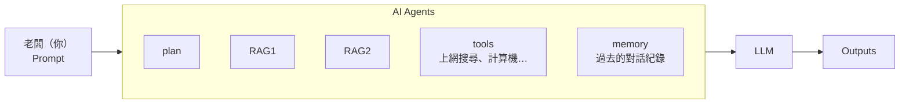
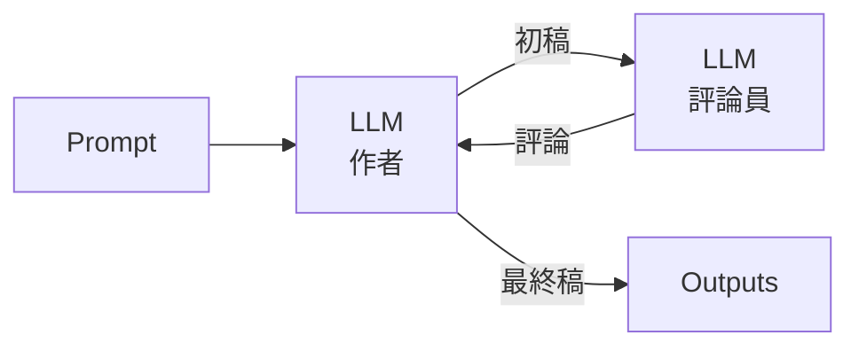
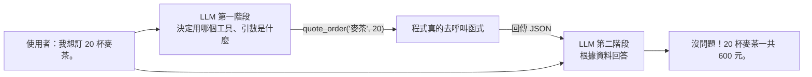

# 第 08 講｜教 AI 做事的方法：AI Agent 與 Agentic Design Patterns

> 課程：生成式 AI 文字與圖像（115 學年度上學期）
> 資料來源：投影片《08 教 AI 做事的方法》（56 頁）＋ 上課錄影（YouTube：<https://www.youtube.com/watch?v=E8SHIZI1E8A>，約 2 小時 11 分）
> 說明：本講義依投影片架構整理，並補上老師上課的口頭解說（標示為 💬 老師補充）。

---

## 本講重點總覽

| 單元 | 主題 | 一句話重點 |
|---|---|---|
| 01 | AI Agents：教 AI 你做事的方法 | AI Agent 沒什麼玄的，就是把「本來你要做的事」教 AI 自動做完 |
| 02 | AI Agent 的設計模式 | 吳恩達的四種模式：Reflection、Tool Use、Planning、Multiagent Collaboration |
| 03 | 進階學習 | Karpathy 訪談（AGI 還要十年、LLM 訓練三階段）、Vibe Coding 的原意、Hinton 談 AI 會比人聰明 |
| — | 作業 | ① 提出期末專案提案 ② 從三種設計模式中選一種，寫一個自己的 AI Agent |

**最重要的觀念**：AI Agent = **教 AI 用「我們做事的方法」做事情**。最後收尾的還是那個「只會文字接龍」的 LLM，重點依然是把最後那個 prompt 寫好——**正確的資訊＋清楚的指引**。差別只在於：收集資訊、規劃、檢查這些苦工，不再由你自己做，而是交給一群 AI「員工」去做。

---

## 💬 課前說明（影片約 0:22 起）

- 今天要介紹的 **AI Agent**「簡直就是生成式 AI 的主軸」，目標是上完課後**對 AI Agent 有深刻的認識，而且知道它沒什麼好怕的**。現在讓大家對 AI 感到恐懼的一大主因就是 AI Agent——外面說得太玄了。
- 本週政大是期中考週，**只上兩節、沒有第三節**（平常第三節會安排講座，讓大家看看外面生成式 AI 的世界）。
- 本週有兩件事（像兩個作業）：
  1. **提出期末專案的提案**：不用做完，但要先提案。
     - 怕有同學提了**太簡單**的專案，到期末才說不行就慘了。
     - 也有同學相反，提了**太難**的專案——做完都可以拿去當碩士論文或拿去賣錢了。助教或老師會跟你討論怎麼調整：目標可以是那個，但不用一下子就做到那一步。
  2. **自己打造一個 AI Agent**：自己做過一次，就知道「AI Agent 就這樣啦，沒有什麼太神奇的地方」。外面很多工具，其實只是讓你**更容易**打造 AI Agent。

---

## 01. AI Agents：教 AI 你做事的方法

### 1.1 很多人說 2025 是 AI 元年，但 AI Agents 到底是什麼？

投影片引用 AI 經典教科書 Russell & Norvig《Artificial Intelligence: A Modern Approach》的定義：

> 代理人是指任何能夠透過**感測器**感知其環境，並透過**致動器**對該環境採取行動的實體。

💬 老師補充：
- 外面介紹 AI Agent 時**太多人引用這一句**了，畢竟是「聖經級」的 AI 教科書。但看完這句話，應該沒有人會因此就懂 Agent 是什麼。
- 問題在於：這本書**第一版是 1995 年**（上個世紀）；最新版是 **2021 年**——那時 **ChatGPT 還沒出現**，完全沒有考慮到現在用大型語言模型做 AI Agent 的情境。
- 這句話「可以拿出去嚇人，但**你不要自己被騙**」。本課程的大目標之一：讓你變成**很有 AI 素養、會嚇別人的人，而不是老被別人嚇到**。
- 💬 關於「AI Agent 元年」：老師去年開課時很得意地說「今年就是 AI Agent 元年」，結果現在已經變成「去年」了。不過 AI Agent 基本上還是那個 AI Agent。有新東西出來，如果你懂原理，只會覺得「對我更方便、更簡單」——就像買新手機，有新功能是興奮的，不是焦慮的。

### 1.2 我們的定義

> 其實在 LLM 時代，基本上就是**教 AI 用「我們做事的方法」做事情**。
>
> **AI Agent = AI Model + Harness**

💬 老師補充：
- 所以如果你**從來沒有什麼事情要做**，就沒辦法用 AI Agent。但只要你本來就要請 LLM 幫忙做事（做摘要、寫報告……），AI Agent 就是教會 AI 用你的方法去做。
- **專業領域知識非常、非常、非常重要，不是別人可以取代的。**
  - 例子：做一個 LLM 檢查企業**永續報告書有沒有「漂綠」**（明明沒做，卻宣稱公司多注重環保、永續）。
  - 如果你不是這個領域的專家，就不知道專家會怎麼看、要做哪些檢查，只能跟 ChatGPT 說「這是某公司的永續報告書，請告訴我它有沒有漂綠」——沒了。效果當然不會太好，因為你完全沒有教它。
- **AI Agent = AI Model + Harness**：AI Model 指 GPT、Claude 或開源模型等；Harness 是什麼，後面課程會再好好介紹。老師認為這個定義「如果想通的話，真的就是在描述 AI Agent」，不是純粹嚇人。

### 1.3 回到那些「可怕的」詞，今天又前進一些……

```
Prompt Engineering  →  Context Engineering  →  Harness / Loop / Graph Engineering
   （Chat Bot）           （兩者的交集）               （AI Agent 的世界）
```

💬 老師補充：
- 2022 年左右只有 **Prompt Engineering（提示詞工程）**。
- 後來出現 **Context Engineering（內容／上下文工程）**——就是寫好 prompt 兩件事之一：**提供足夠多的正確資訊**。（老師自嘲投影片上把 Context 拼錯成 Contex）
- 上次學的 **RAG**，就是讓 AI 自己去找資訊——這其實就是 AI Agent 的概念。所以 Context Engineering 位在「純對話機器人」和「AI Agent」的**交集**。
- 再往後就進入純 AI Agent 的世界：**Harness Engineering、Loop Engineering、Graph Engineering**……很多酷炫的名詞會出現，但不要害怕，要了解它到底是什麼意思。
- 我們會學到：**AI Agent 其實只是「教 AI 做事的方法」**。

### 1.4 非常多的討論、吳恩達 2024 年就開始推

- 投影片 P6：各國媒體（中、日、韓文）都在報導 AI Agent，例如 OpenAI 推出代理工具「Operator」、「AI Agent 是邁向 AGI 的關鍵一步？」等。
- 投影片 P7：**What's next for AI agentic workflows ft. Andrew Ng of AI Fund**

💬 老師補充：
- AI 大佬**吳恩達（Andrew Ng）在 2024 年就開始力推 AI Agent**，現在大家對 AI Agent 的認識，跟他 2024 年這場演講很有關係。影片**只有 25 分鐘左右**，推薦去看，內容就是今天要講的。
- 2024 年他引導大家思考 AI Agent 應該長什麼樣子 → 2025 年大家照這個方向走（AI Agent 元年）→ 2026 年方向越來越成熟、想法越來越多。

### 1.5 為什麼「下一個 prompt、LLM 直接輸出」不夠？

```
Prompt → LLM → Outputs
```

以前的對話機器人：下 prompt，LLM 輸出，就結束了。

💬 老師補充：
- 即使是想用「一個 prompt」解決問題，那個好 prompt 通常也是跟 AI **來來回回討論**後才形成的。
- ⚠️ 到了 AI Agent 時代，**LLM 能做的事還是只有文字生成（文字接龍）**。所以「AI Agent 時代 prompt 就不重要了」是錯的，**把 prompt 寫好依然最重要**。
- 外面常聽到這種奇怪的言論：「這個問題好像有點困難，是不是要考慮用 AI Agent 的方法去做？」——聽起來很有道理，其實**什麼都沒講**：要用哪一個 AI Agent？怎麼做？不是說出「Agent」這個字，問題就會解決。

#### 但對人來說都不容易（吳恩達的比喻）

> 這就好比要一個人寫一篇文章，但**不可以用刪除鍵、不可以修改**，一路寫下去。人很難做到這樣……

💬 老師補充：
- 想像考作文：**不准打草稿**（腦中想也不行），每次**只能想下一個字**，寫完覺得不好**也不能回頭改**。
- 這正是 LLM 在做的事：每次只想下一個字，用**機率抽**出一個字，接得順就定下來，再決定下一個字，一路寫下去。因為它看過的資料實在太多，第一次選的字已經「差不多有點順」，所以看起來還蠻厲害的，但其實很難做好。
- 我們人寫文章會：**先打草稿**（要用什麼例子、哪裡放金句）→ 寫 → **再讀一次** → 不順就修改。
- **寫程式也是這樣**：我們喜歡一邊寫、一邊試、一邊改。即使你不太懂程式，跑起來也會覺得「應該換個寫法」。
- 那可以教 AI 這樣做嗎？**當然可以**——這就是 AI Agent。

### 1.6 要做好 Context Engineering，我們要做不少的事

| prompt 兩大核心 | 說明 |
|---|---|
| **正確的資訊** | 它不知道你腦中的背景——把該給的資料、條件講清楚 |
| **清楚的指引** | 要它做什麼、輸出成什麼樣子、給誰看，講明白 |

為了給出「正確的資訊」，我們可能要：

- **查一下規定**（→ 用 RAG）
- **上網搜尋**（例如剛發生的事，LLM 不知道詳細內容）
- **按一下計算機**（💬 LLM 完全是**憑感覺算數學**，出錯機會非常大）

此外也可能不時和 LLM 溝通：

> 我：「你說的某某地方，實際上的情況是……另外，某某地方是否可以改為……」
> AI：「收到，我來改。」

💬 這是我們把 LLM 用好、讓成品真正符合需求時**本來就會做的事**。現在要想的是：**這些本來是我們要做的事，可不可以叫 AI 自動幫我完成？**

### 1.7 AI Agent：本來你要做的，AI 自動幫你做完！

> 舉凡**規劃、收集資料、不斷迭代嘗試**等等，都告訴我怎麼做、我來做！

- 💬 例如讓它多試幾次、自己給自己評分，寫得不好就自己再改。

#### RAG 其實也是一種 AI Agent——我們已經碰過 AI Agent 了！

- 「正確的資訊」由**電腦自動找到相關的資訊**。
- 💬 這就是為什麼先講 RAG：AI 自動去找資料，找到後放進 prompt，說「這是我找出來的資料，請根據這些資料回答問題」。它能「很神奇地」回答，其實是因為**我們告訴它答案了**——唯一的差別是讓 AI 自己去做。

#### 現在更多「員工」幫忙找足夠資訊

| AI 員工 | 負責的事 |
|---|---|
| 「我來用 RAG 找內部相關資訊。」 | 查內部規定、文件 |
| 「我幫忙上網收集資料。」 | 網路搜尋 |
| 「我按計算機檢查一下數字。」 | 精確計算（例如一起訂飲料的總金額） |
| 「寫出來的東西讓我檢查一下。」 | 檢查、評論 |

💬 老師提醒：
- 不管 AI 自己有沒有檢查，**最後出來的東西你還是要自己看一次**。
- AI Agent 的好處是：**第一次給你的版本就比較好**。但不是「用了 AI Agent 什麼都解決了」——**你的 AI Agent 要做什麼事，是你要告訴它的**，不是它自動就會。

### 1.8 現在老闆（你）一句話，員工（AI Agents）動起來！



💬 老師補充：
- 標題本來想寫「**慣**老闆」，但字數到極限了 😆——你就像慣老闆，**出一張嘴**，就有負責**規劃（plan）**的 AI Agent 說：「這時候要查資料，RAG 1 號去查這份、RAG 2 號去查那份；要上網搜尋、要按計算機的，工具們各司其職；也從過去的討論紀錄（**memory**）裡找資料。」
- 大家收集來的資料、正確的數字，最後都塞進 prompt：「使用者（大老闆）原本的問題是這個，請根據這些資料回答。」
- **最後還是要一個 LLM 收尾**，做的事情還是一樣：把最後那個 prompt 寫好——**足夠多的正確資訊＋清楚的指引**。只是大老闆不用自己想清楚、不用自己收集資料。
- 所以**你的 AI Agent 會跟我的 AI Agent 長得不一樣，那才是正常的**。不用到處跟人要「你的 AI Agent 可不可以 copy 給我用」，效果通常有極限——**自己設計的才完全符合自己的需求**。
- 從**下週**開始要教的方式，「感覺真的超級棒」，會讓你真的像慣老闆一樣。

---

## 02. AI Agent 的設計模式

### 2.1 吳恩達：AI Agents 的四個設計模式（Design Patterns）

影片：<https://youtu.be/sal78ACtGTc>

| 設計模式 | 中文 | 一句話 | 範例程式 |
|---|---|---|---|
| **Reflection** | 反思 | 一個寫、一個評，來回修改 | <https://yenlung.me/AI07a> |
| **Tool Use** | 使用工具 | LLM 不擅長的，呼叫工具來幫忙 | <https://yenlung.me/AI07b> |
| **Planning** | 規劃 | 先「想一想」、「打草稿」再正式回應 | <https://yenlung.me/AI07c> |
| **Multiagent Collaboration** | 多代理合作 | 多個 AI Agent 一起工作 | — |

💬 老師補充：
- 這是吳恩達在 2024～2025 年（AI Agent 元年）時的整理，**2026 年其實也還是這些模式**。
- 再強調一次：沒有什麼特別難的地方，還是那句老話——**我們怎麼做事，就教 AI 怎麼做事**。所以**不是只有這四種**，還有很多可能性，每個細節大家的做法也不一樣。
- 第四種「多代理合作」在現在看來「簡直是廢話」：做 RAG 的 Agent 不見得只做 RAG，可能還要上網搜尋，搜尋結果要先過濾、做摘要才丟給 prompt；寫稿的寫完初稿，有人要查證、有人要檢查語句通不通順……多個 Agent 一起工作是現代最自然的用法。但 2024 年大家連 AI Agent 是什麼都還搞不清楚，所以當時特別列為第四種。
- **所以今天實際上學前三種。**

---

### 2.2 Reflection（反思）

> 第一個 LLM 產生**初稿**，第二個 LLM 進行**評估、提供改善建議**，然後第一個 LLM 進行修改。可重複數次。



💬 老師補充：
- **其實可以是同一個語言模型**，只是 **system prompt 下得不一樣**，看起來就像兩個對話機器人：
  - **作者**：告訴它要寫哪種報告或文章、寫的時候要注意什麼——教它寫。
  - **評論員**：教它「一定要**銳評**」，逐一檢查作者寫的重點有沒有寫錯、文字通不通順。評論標準要**依你的需求**設計：寫正式報告和當小編寫社群貼文，風格與注意事項完全不同。
- 流程：作者寫初稿 → 初稿當作評論員的 prompt → 評論員產生評審意見 → 把「原文＋意見」再塞給作者：「根據這些意見修改一下」→ 作者修改。
- **要來回幾次？隨你高興。**
  - 可以改一次就停，也可以改完再評、再改。
  - 更常見的做法：再做一個**評分機器人**，判斷文章夠不夠好；沒達標就再給評論員狠狠評一次、再修改。
- 程式寫起來沒什麼難的，知道原理就非常簡單。

#### 當然「評論員」可用不同模型

- 💬 如果發現某個模型「比較會罵」，就讓它當評論員、不要讓它寫。
- 就像生活中有些人**不會寫，但很會挑錯**：「這個沒弄好、那個不對、聽起來怪怪的」。
- 總之：**用兩個不同的模型，或同一模型下不同 system prompt，打造兩個對話機器人**都可以。

---

### 2.3 Tool Use（使用工具）

> 不是 LLM 擅長的，或者不會的，**呼叫工具**來幫忙。

💬 老師補充：
- 很多人以為 Tool Use 就是 AI Agent 的全部——**不只這樣**。
- LLM 除了「接話、胡說八道」之外**什麼都不會**，它只會生成文字。

💬 **老師最愛舉的例子：整理電腦桌面**
- 桌面很亂，你請 LLM 建議怎麼分類資料夾。它不能讀你的電腦，所以你得**自己把所有檔名給它**。
- 它建議完分類、每個檔案放哪裡，然後說「請你照著做」——你開始建資料夾、一個一個搬檔案，覺得自己「**比較像幫 LLM 打工的工讀生**」。
- 搬檔案寫個小程式就能做。如果讓 AI 擁有**處理檔案的能力**，它就能自己搬——這就是 Tool Use 的概念。

#### LLM 不太會做的事，就不要再逼它了……

| 不要逼 LLM 做的事 | 💬 老師說明 |
|---|---|
| **精確計算** | 不要再問 LLM「多少加多少」然後笑它算錯。現在好像越答越好？本質沒變，是因為它們**偷偷用了工具** |
| **實際數據** | 例如問「政大有多少學生」，它會隨便答一個數字（1000？） |
| **網路搜尋** | 現在能答出實際數據，是因為它會上網搜尋 |

> 💬 它唯一做的事就是生成下一個字，覺得合理就放上去。**它產生的全部都是幻覺**——只是想辦法天馬行空、很順地把句子生出來。

#### 範例：打造飲料店的 ChatBot

> 客人：「我想訂 20 杯麥茶。」
> ChatBot：「沒問題！20 杯麥茶一共 600 元。」

💬 這個 ChatBot 應該要：
- 檢查有沒有賣麥茶、庫存夠不夠做 20 杯、一共多少錢。
- 處理更複雜的訂單（5 杯麥茶＋10 杯別的……）。
- 賣完或數量不夠時，要能跟客人溝通。
- 甚至接上記帳系統。這樣就不用人接電話，專心做飲料就好。
- 但**沒有任何 AI 知道你家的菜單和庫存**——所以要寫小工具（函式）。

**步驟一：告訴 AI 有什麼工具（函式）可以用**

| 工具 | 功能 |
|---|---|
| `quote_order` | 輸入**品項、杯數**，回傳單價、總金額、庫存是否足夠等 |
| `get_menu` | 回傳菜單（menu） |

- 💬 實際應用當然需要更多工具，課程為了好展示只做兩個。重點在第一個；第二個「有點騙人」，就只是回傳菜單。
- 怎麼讓 LLM 知道有這兩個工具？沒什麼難的，**直接在 system prompt 裡告訴它**：我有兩個工具，`quote_order` 做什麼、`get_menu` 做什麼，覺得需要就去呼叫。

**步驟二：LLM 實際上參與兩個階段**



1. **第一階段——決定呼叫哪個工具、引數是什麼**：
   - LLM 看到「我想訂 20 杯麥茶」，判斷要呼叫 `quote_order("麥茶", 20)`。
   - 要教它：這個函式需要兩個引數，第一個是**品項**、第二個是**數量**，從使用者的話中擷取出來。
   - 💬 這時它**還不需要回答**，因為還沒有資料可以回答——就像 RAG 的第一階段先去找資料。
   - 💬 真正呼叫函式的是**程式**，LLM 只負責決定「要呼叫什麼、引數是什麼」。

2. **呼叫工具（函式）**，回傳結果：

```json
{
  "ok": true,
  "item_name": "麥茶",
  "quantity": 20,
  "unit_price": 30,
  "total": 600,
  "stock": 30,
  "currency": "TWD",
  "ordered": false
}
```

3. **最後請 LLM 由資料中回答使用者問題**：

```text
請根據這些數據：
{ ……上面的 JSON…… }
回答「我想訂 20 杯麥茶。」的問題。
```

→ 輸出：「沒問題！20 杯麥茶一共 600 元。」

💬 老師補充：
- **回傳的資料要偷偷幫它算好總金額**。不能只回傳單價——雖然 30 元 × 20 杯 = 600 元對你來說很簡單，但 LLM 算的時候**完全拼感覺**。
- 範例程式用的是**簡化版的 AISuite**。AISuite 其實能做很多事，但刻意簡化，是希望大家**看到中間到底發生了什麼事**。
- 跟 Reflection 一樣，其實就像兩個對話機器人：第一個負責收集資料，第二個負責回答。

#### 電腦很喜歡看到 JSON 格式的資料

> **JSON 基本上是用文字描述「有欄位名稱的資料表單」。**

- 💬 寫過程式的人會認得這是 JSON。它沒什麼了不起，就是**把一張表格變成一段文字**。
- AI 很習慣看 JSON，**不要跟它囉哩八唆，直接把 JSON 丟給它**就好。如果改給一張表格圖片，還需要多模態 AI 才看得懂，而且常常讀錯。

#### 工具不一定要自己寫

> 很多平台可以讓你連結工具。比如說上網搜尋啦、比如說你的 email，甚至就處理你桌面檔案。

💬 老師補充：
- ChatGPT、Claude 等都能**連結** Gmail、處理你電腦上的檔案……網路搜尋更是不用你連結，它就偷偷幫你做了。
- 第一階段它要決定「這時候該呼叫網路搜尋」；連到 email 時，也不是單純連結，而是**連上去後由 LLM 幫你讀**，告訴你哪些信件在等你回應。

#### 甚至你也可以分享給別人使用：MCP 與 A2A

| | **MCP**（Model Context Protocol） | **A2A**（Agent-to-Agent） |
|---|---|---|
| 提出者 | **Anthropic** | **Google** |
| 關注 | 單一 Agent 如何規劃和**使用外部工具** | **Agent 之間**的溝通 |
| 說明 | 標準化 LLM 與外部工具、資料來源或環境的互動方式 | 定義代理之間交換資訊、協作和協調的方式 |
| 一句話 | 與**外部世界**溝通 | **代理之間**溝通 |

💬 老師補充（MCP）：
- ⚠️ **MCP 不是使用工具的唯一方式**。外面常聽到「我會 MCP，我的模型變高階了」——沒有什麼高階。
- MCP 就是工具呼叫的**標準規範**。符合規範的工具，**ChatGPT 能呼叫、Claude 能呼叫、開源模型也能呼叫**，只要它知道 MCP 的規範。
- 兩個方向的好處：
  1. **用別人的**：外面有人做了一個服務，說可以用 MCP 呼叫，那你就安心了，照 MCP 方式用就好。（有些要付費。）
  2. **給別人用**：你寫了一個很棒的小工具（例如飲料店查庫存），團隊裡其他人開發的 AI Agent 也想用——你建立一個 **MCP server**，別人就能用。
- 有些 MCP 工具需要你**在自己的電腦上建立 MCP server** 來執行，再讓你的 LLM 去呼叫。

#### ⚠️ 工具不是越多越好

- 💬 LLM 選工具時，完全是用「**語言模型的思維**」：你只是告訴它有哪些工具，它看到這句話就「覺得」應該選哪一個。
- 工具**太多**、或有些工具**功能有模糊空間**（這個也可以、那個也可以），它就可能選錯。
- 懂原理之後，你自然就會注意到這些問題。

#### Tool Use 其實是很寬廣的主題

- 💬 工具裡面也可以**再包一個 LLM**。例如上網搜尋後，先用 LLM 做**摘要**、判斷哪些文字要留，再回傳摘要而不是全文。
- 很多事都可以變成 Tool Use 的形式。

---

### 2.4 Planning（規劃）

> 先請 LLM「**想一想**」、「**打草稿**」再正式回應。

```
prompt → LLM：「我先來規劃要怎麼進行，比較好完整回覆使用者需求。」
          1. ….
          2. ….
          3. ….
       → 再依規劃正式回應
```

💬 老師補充：
- 現在很多 LLM 都說自己「**會思考**」、思考能力比較好或比較差——**它的「思考」其實就是在做 Planning，白話文就是「打草稿」**。
  - 「語言模型哪一個部分會思考？沒有部分會思考。」所謂思考模型，就是先打草稿。
- 打草稿通常會比較好；沒有比較好，就是草稿沒打好，那就讓它的草稿再打好一點。
- 一樣是**兩個階段**：第一個對話機器人看到 prompt，**先想清楚、不要直接回答**；第二階段再依草稿回答。

#### 例如 CoT（Chain-of-Thought，思維鏈）

CoT 是一種有名的方法，可以：

- 有系統地**拆解**複雜議題
- 找出議題間的**關聯性**
- 更完整地**涵蓋各個面向**
- 容易看出**優先順序**

💬 其實就是**教 AI 打草稿**。每個人教 AI 打草稿的方式不一樣，你高興怎麼教就怎麼教。就像演講前先想好主題再講，通常會比什麼都沒想就開口好（除非是很厲害的人）。

#### CoT 是讓 DeepSeek-R1 厲害的關鍵

- 先產生「思考」，用 `<think>` 和 `</think>` tag 包起來，再正式回答。
- 💬 DeepSeek-R1（2025 年初）讓大家覺得很厲害的重大原因，就是它**經過思考才回應**。很多模型現在也這樣，但思考過程常常一閃而過；DeepSeek-R1 剛出來時會**完整寫出思考過程**。
- 💬 老師示範：請它用生活化的方式解釋「唯識學」是什麼。灰色部分是思考過程——它以為在回答你，其實是先規劃（定義、學習方法、與生活連結、避免術語、用比喻……），**再根據思考過程回答**。整個模型的訓練主力，就是產生好的思考。

#### 或許我們可以做得更好！

> 像 DeepSeek-R1 這種模型，目標是**任何問題**都能產生好的思維。
> 如果我們只是**單一型的任務**，當然有可能打造更好的「思考」。

💬 老師補充：
- 思考模型的思考是**通則**，因為它要回答的問題包山包海。
- 我們常常只做**單一型的應用**（例如很會寫某種報告的對話機器人），思考的規範非常明確，所以**有機會產生比通用版更好的思考**。
- 也就是說：**每一個語言模型，你都可以想辦法調校得更厲害一點**；我們還是很有機會做出比直接用通用對話機器人更好的東西。不用一直擔心「哪個模型最好」。

---

### 2.5 Multiagent Collaboration（多代理合作）

> 多個 AI Agent 一起工作。

#### 常常有位如 PM 角色的 LLM 分配工作

> PM：「任務拆解完成，1 號幫我算這個，2 號去查 XXOO 資訊，3 號依資訊分析理由……」
> 4 號：「這次沒我事。」

💬 老師補充：
- 通常會有一個 **Planning 型的機器人擔任 PM**，接到問題就分派：工具機器人看要呼叫什麼工具、RAG 機器人判斷要不要查、用哪一個 RAG 查、要不要從過去的對話**記憶**裡找……有時全部動到，有時不會。
- 分配完還沒結束：例如「寫文章組」裡，一個 AI 寫、一個 AI 批評，來來回回討論好幾次才交出來。
- 總之：**你是大老闆，說一句話，PM 去分配工作，大家在那邊做得天花亂墜。**
- 💬 現在的 AI 產品為什麼做得好？一個重大原因是**中間有很多檢查的過程**（所以也越做越久）：
  - 每次結束時交給**評分機器人**評分，沒做好就重做。
  - 也有人喜歡自己看：評論一次、修改一次後自己看，不行就**打回去**。
  - 你不一定要寫很多意見，有時只要下「**老闆級的意見**」——出一張嘴說「這一段沒寫好」，它就會再去改。

---

## 03. 進階學習

### 3.1 Andrej Karpathy — AGI is Still a Decade Away

- 訪談連結：<https://www.dwarkesh.com/p/andrej-karpathy>

**Karpathy 的重要想法（投影片 P41）：**

| 想法 | 💬 老師解說 |
|---|---|
| **AGI 距離現在還有十年**：現在的 AI 還不像真正人類實習生 | 2025 年叫 AI Agent「元年」，中文翻得完全正確——**就是第一年**，還沒結束。要真正把 AI Agent 用到成熟，大概還要**十年左右**。2026 年確實看到很多跟 2025 年不一樣的地方，但主要是**我們使用的方法越來越純熟**，語言模型還是原來的語言模型。 |
| **人類學習不等於強化學習（RL）**——RL 很糟糕 | 模型出廠前會用強化學習（reinforcement learning）調教怎麼回答問題；但人類的學習方式不太像強化學習。（強化學習之後的課會教） |
| **模仿人類的網路（LLM）「知識壓縮」障礙** | LLM 也不是真的模仿人類，就是預測下一個字。它把看過的海量文字**壓縮**進一個相對小的模型裡（雖然叫「大型」，相對於看過的字量其實是小的）。壓縮會有**瓶頸**，到某個程度就很難再前進。 |

💬 老師談 AGI：
- AGI（通用型 AI）就像**哆啦 A 夢**那種 AI。LLM 出來後，基本上沒什麼人相信 LLM 就是 AGI——上了半學期課，大家應該很清楚它完全不像哆啦 A 夢，它的思考也不是真的思考，連 AI Agent 都還不是人的思考方式。
- 但有了 AI Agent 之後，很多事真的做得比較好了——**不是丟給 AI Agent 就結束，而是我們用 AI Agent 的技術越來越成熟**。所以「LLM ＋ AI Agent 的設計」會不會變成 AGI？本來包括老師在內都覺得不可能，現在覺得**好像有點可能，但也可能不是**。
- 「AGI 應該就是在大家手上實現的」，大家可以想想這個問題。

### 3.2 LLM 的訓練三個階段

```
Pre-train（預訓練）  →  Post-train（後訓練）  →  Fine-tuning（微調）
   基礎模型                  對齊
```

| 階段 | 做什麼 | 💬 老師解說 |
|---|---|---|
| **Pre-train** | 訓練**基礎模型**：預測下一個字 | 基本上**已經差不多到瓶頸**：用更多資料、更大的模型都做了；大家想得到、可以讀的資料全部都拿去訓練了。所以各家**基礎模型差異沒有那麼大**。聽到有人嘲笑 Gemini、某模型「降智」、某模型現在最厲害……都不要太在意。各家會想辦法在後面把 **AI Agent 設計得好一點**（該檢查的都檢查），讓它顯得聰明、程式一次跑就對。 |
| **Post-train** | **對齊（Alignment）** | 出去嚇人的好用名詞：「我這個 AI 的 alignment 做得不錯」。對齊有很多種：<br>① **對齊企圖**：叫它講笑話，它是不是真的講了一個還蠻好笑的笑話？<br>② **對齊風格**：你喜歡溫暖一點還是理性一點的機器人？<br>③ **價值對齊**：例如有人問怎麼做炸彈、怎麼搶銀行不被抓——**基礎模型什麼都會回答**（對不對是另一回事），所以要讓它不回答、不產生對人類有害的內容。這很難 100% 防範，因為問邪惡問題、引導它回答的方法有千千萬萬種。<br>ChatGPT、Claude、Gemini 回答風格不同，就是後訓練做出來的。 |
| **Fine-tuning** | 用公司自己的資料**微調** | 模型對公司不熟，或公司就喜歡某種回答調調，下 system prompt 也調不好，就用比較少量的資料再訓練。 |

💬 **重要觀念：什麼才叫「訓練」？**
- 以上三種都會**改變模型的參數**，才叫訓練。
- 用 **RAG** 給模型資料、改 **system prompt**——**都不算訓練**，因為完全沒有改到模型本身的參數。
- 絕大部分的使用情境，這三種訓練**我們都沒做**。所以不要再跟人家說「我訓練了我的 AI 模型」，問清楚才發現只是做了 RAG——**那完全不叫訓練**。

### 3.3 Vibe Coding 到底是什麼呢？

> 2025 年 2 月 **Andrej Karpathy** 在 X 的貼文，創了 **Vibe Coding** 這個新詞。

💬 老師說「沒有時間了，很快說一下」——前面的作業其實已經做過 Vibe Coding 了，這不是今天的重點。

#### 原版 Vibe Coding 全文大意（投影片 P44–45）

- 一種新的寫程式方式：**完全順著感覺（vibes）走**、擁抱指數成長，**忘記程式碼的存在**。之所以可行，是因為 LLM（例如 Cursor Composer 搭配 Sonnet）變得太強了。
- 他用 SuperWhisper 直接跟 Composer **講話**，幾乎不碰鍵盤；連「把側邊欄的 padding 減半」這種小事都懶得自己找，直接叫 AI 改。
- 永遠按「**Accept All**」，**不再看 diff**（程式改了哪裡）。
- 遇到錯誤訊息就**直接複製貼上**給 AI、不加任何說明，通常就修好了。
- 程式碼長到超出他平常能理解的範圍；有時 LLM 修不好 bug，他就繞過去，或隨便要求改東改西直到 bug 消失。
- 對「**週末拿來玩、用完即丟的小專案**」還不錯，也挺好玩的。他是在做專案或網頁應用程式，但**其實不算在寫程式**——只是看東西、說東西、跑東西、複製貼上東西，而且大多能動。

#### Vibe Coding 重點

1. 忘了有程式碼這件事
2. 不要幫 AI 檢查程式碼
3. 有錯就叫 AI 改
4. 最高級的技巧是 Copy & Paste
5. 完全不看程式、不改程式

💬 老師補充：
- 既然這個詞是 Karpathy 創的，就應該**完全照原創者的意思**：Vibe Coding 最重大的精神就是**忘記程式碼的存在**。
- 如果你**有去看程式、有去改程式**、出錯時有去看程式——**那都不叫 Vibe Coding**。
- 會不會有危險？**當然有。** 有 bug 就出一張嘴叫它改；真的改不了，那個 bug 可能永遠改不掉，甚至交出去時還不知道有 bug。
- 為什麼**會寫程式的人通常 Vibe Coding 還是做得比較好**？
  1. 他們**規格書**寫得比較好——不過我們學過「高階技巧」（其實不高階）：**跟 AI 討論**，讓 AI 幫我們把規格書寫好，所以這點現在也不錯了。
  2. 出錯時他們知道**該往什麼方向調整**；沒有寫程式經驗的人比較難做好這件事。

#### Vibe Coding 並不是「AI 輔助寫程式」

> **Vibe Coding ≠ AI 輔助寫程式**

- 💬 不是用 AI 輔助寫程式就叫 Vibe Coding。例如寫作業時請 AI 寫出來，但**你有去看、確定它是對的**——那就不叫 Vibe Coding，那**比 Vibe Coding 還要高階**。
- 💬 大部分的人機協作寫程式，尤其是**正式場合，都不應該是 Vibe Coding**。

**Merriam-Webster 字典的定義（投影片 P48）：**

> Vibe coding（也寫作 vibecoding）是一個最近創造的術語，指的是通過告訴 AI 程式你想要什麼，讓它為你創建產品的編碼、製作網頁或開發應用程式的做法。在 vibe coding 中，程式設計師**不需要理解程式碼如何或為何運作**，且通常必須**接受存在一定數量的錯誤和故障**。該詞的動詞形式是 vibe code。

#### Vibe Coding 應該怎麼翻呢？

隨興程式設計法｜擺爛程式設計法｜耍廢式程式設計｜直覺流程式設計

#### Vibe Coding 適合／不適合什麼？

| ✅ 適合 | ❌ 不適合 |
|---|---|
| 週末好玩的小專案（Karpathy） | 要**正式上線**的程式（所以不是有 Vibe Coding，老闆就可以 fire 掉工程師） |
| 給自己使用、出錯不會怎樣的小工具 | **不檢查可能會出亂子**的程式 |
| 試做的**原型**，和程式設計師討論 | |

💬 老師補充：**最適合的是做原型**。例如你在金融業，用 Vibe Coding 做出一個覺得很不錯的東西，公司要上架時交給正式的軟體公司開發——因為你已經做出原型，**需求會說得非常清楚**。

#### Karpathy 對 Vibe Coding 有意見是誤讀（投影片 P52）

Karpathy 在訪談中提到 AI 時代三種寫程式的方式：

1. **完全不用 LLM**（純手工）——Karpathy 認為不合理
2. **人類主導＋自動補全**
3. **Vibe Coding**：把需求用自然語言丟給 LLM 生成整段程式

而且這「**不是**」那次訪談的重點。（外界把它解讀成「Karpathy 對 Vibe Coding 有意見」是誤讀。）

### 3.4 Hinton：Will AI Outsmart Human Intelligence?

> 💬 老師上課時間不夠，這部分沒有口頭講解，請大家**自己看投影片**。以下依投影片整理。

**人工智慧的兩大學派：**

| 學派 | 英文 |
|---|---|
| 符號式邏輯學派 | logic-inspired AI |
| 生物學式學派 | biologically-inspired AI |

（補充：神經網路、深度學習屬於「生物學式學派」，Hinton 正是這一派的代表人物。）

**Hinton 的看法：AI 將會比人類聰明**

- AI 已經在以**與人類相同的方式理解世界**
- AI 將會**比我們聰明，且想要控制**
- AI 甚至可能有**主觀經驗**（subjective experience）

---

## 04. 作業：打造你自己的 AI Agent

### 4.1 本週兩項任務

| 任務 | 說明 |
|---|---|
| ① **上傳期末專案計畫（提案）** | 讓老師和助教幫忙看**可不可行**，不要太簡單、也不要寫出「太可怕」的東西。歡迎多利用 **Office Hours** 找助教討論。 |
| ② **自己打造一個 AI Agent** | 從 Reflection、Tool Use、Planning 中**選一種**，照範例修改成你自己的問題。**只要做一個就好**（願意都做也可以）。 |

- 💬 本週是期中考週，沒有第三節，可以先準備其他科目的期中考；作業等考完再開始做也可以。

### 4.2 三個範例程式

| 設計模式 | 範例 | 內容 | 適合誰 |
|---|---|---|---|
| Reflection | <https://yenlung.me/AI07a> | 作者機器人＋評論員機器人，來回修改 | 想做「改三次再交給大老闆」的人 |
| Tool Use | <https://yenlung.me/AI07b> | 飲料店 ChatBot（`quote_order`、`get_menu`） | **程式比較熟**、覺得另外兩個「沒什麼技術含量」的人 |
| Planning | <https://yenlung.me/AI07c> | **員瑛式思考生成器**（先打草稿再寫） | ⭐ **老師推薦**，特別是還不太會寫程式的同學 |

💬 **為什麼要自己寫程式？**
- 很有可能，這是你**一生中唯一一次自己寫程式打造 AI Agent**（除非你以後就是要當 AI 工程師）。日常使用 AI Agent 時，你多半不需要寫程式。
- 但還是要寫，理由很簡單：
  1. **沒什麼難的**，有範例。
  2. **有 AI 幫忙**：你不想照範例做，只要懂原理，也可以叫 AI 寫給你。
  3. 不管是叫 AI 改還是照範例改，你都要**知道中間發生了什麼事**，才知道怎麼改。
- 💬 就像 RAG：未來實務上你可能不寫 RAG 程式（工具太多了），但你一定要知道它**怎麼切文字塊**等細節。不是「上傳到 Gemini／NotebookLM，就說我做了 RAG」——有說跟沒說一樣。老師看過很多研究生論文說用了 RAG，看完發現好像根本沒做 RAG，因為只聽過這個詞。
- 這份作業的價值在**練習**：品味一下自己寫 AI Agent 的**感覺與感動**，不是要做出什麼偉大的 AI Agent。用跟標準範例差不多的寫法就好。
- 程式比較強的同學也可以挑戰第四種——讓 1 號、2 號、3 號 AI Agent 互相合作。

### 4.3 示範：Planning 範例（員瑛式思考生成器）

> 員瑛式思考：把倒楣的事，用**很正向、幽默**的方式轉成「其實我很幸運」說出來。上次的版本是一次生成；這次要讓它**先打草稿、想好怎麼寫，再寫出來**。

1. 開啟 `yenlung.me/AI07c` → **在雲端硬碟中儲存副本** → 連線。
   - 你**不一定要做員瑛式思考**，任何需要打草稿的都可以：寫文章、旅遊規劃……
2. 安裝套件：**AISuite**（呼叫語言模型）、**Gradio**（互動介面）。
3. 語言模型一樣用 **Groq**。
   - ⚠️ 💬 **Groq 免費版有用量限制**。AI Agent 為什麼「**燒 token 燒得比較快**」？今天介紹的三種都**至少有兩個階段**，每個階段都要呼叫語言模型，所以比直接回答燒更多 token。老師測試時就遇到**做到一半被斷掉**。
   - 可以改用**比較小的模型**（例如 120b 可能太大，用到一半就不讓用了）。
   - 要牢靠的話，終究可能要**付費**：用 ChatGPT、Claude 等要付 **API 使用費**（不是一般的月訂閱）。
4. 讀入 API 金鑰（Colab 密鑰沒開存取權時要**授予存取權**）。這段程式是 ChatGPT 寫的，所以比老師自己寫的複雜很多，還附了各種錯誤檢查。
5. **共用的 LLM 呼叫函式**：每次都傳入「system prompt＋user prompt」。因為每個階段要做的事都相對單純，同一個函式配上**不同的 system prompt**，就是不同的對話機器人：
   - Tool Use 第一階段：決定用哪個工具、引數是什麼
   - Reflection 第一階段：教它怎麼寫文章
   - Planning 第一階段：教它怎麼思考
6. 連線測試：預設設成 `False`（大部分時候不用測），想測就改成 `True`。
7. **第一階段：思考（打草稿）的 system prompt**——可以先跟對話機器人好好討論出來。重點包括：
   - 先確認**已知的事實**（使用者說了什麼）
   - 最大的**失落**在什麼地方
   - 想辦法**正向連結**這兩件事
   - 先寫出**兩個比較幽默**的例子，最後再挑一個較好的
     - 💬 老師原本要五個，但 ChatGPT 覺得每次五個太過分，後面可能會「濫竽充數」。
   - 如果是**真正的悲傷**事件，就**不要硬說成幸運**——只有小小的倒楣事才轉。
   - 測試例子：想吃的可頌賣完了（店員也沒說下一批馬上出爐）→ 第一階段輸出思考內容。
8. **第二階段：正式產生員瑛式思考**的 prompt——把第一階段的思考送進去，再產生最後結果。
   - 💬 老師提醒：現在生成式 AI 很喜歡幫我們寫出**超級長、鉅細靡遺**的 prompt，但有些模型其實**吃不下去**，要自己試驗才知道。
   - 示範結果：「決定把這次的錯過當成探索早餐的機會，走到隔壁店找找意外的甜點」——老師評論：應該要說「真的找到了」才對，不然哪有 lucky 的部分？**沒寫好就回去改思考或寫作的 prompt。**
9. 後面很多格是測試用的（預設 `False`），除非出錯要找問題，否則不用看。
10. **啟動 Gradio 介面**：這格範本已預設為 `True`（避免一路按下去不小心啟動，其他格多半是 `False`）。
    - 示範：「出門前開始下雨，只好待在家，很掃興」→ 畫面會**同時顯示思考過程**和最後結果。
    - 一般的 AI 不會給你看思考過程，但我們在練習，所以顯示出來；覺得思考寫得不好，就改成**你覺得比較好的思考方式**。

💬 **其他兩種的做法提示**
- **Tool Use**：自己寫（或叫 AI 寫）一個小程式，要求**輸出 JSON 格式**，AI 就會幫你做好。
- **Reflection**：可以直接叫它改三次；也可以做**評分機器人**，通過才交給你；更偉大一點，三次用**不同的機器人**來評。自由發揮。

> 💬 做完思考型的對話機器人，你會更清楚：**「思考」有點是騙你的**——它不像人的思考，比較像打草稿，**而且打草稿的方式是你教它的**。所以真的沒有那麼神奇。

---

## 名詞對照表

| 名詞 | 說明 |
|---|---|
| AI Agent（AI 代理人） | 教 AI 用「我們做事的方法」做事；AI Agent = AI Model + Harness |
| Harness | 包在 AI 模型外面、讓它能做事的那一套機制（後續課程會再介紹） |
| Prompt Engineering | 提示詞工程：寫好 prompt |
| Context Engineering | 上下文工程：給 AI 足夠的正確資訊（＋清楚指引） |
| Harness / Loop / Graph Engineering | AI Agent 時代出現的新名詞，不用害怕，懂原理就好 |
| Agentic Workflow / Design Patterns | 吳恩達提出的 AI Agent 工作流程與設計模式 |
| Reflection（反思） | 一個 LLM 寫初稿、另一個評論，來回修改 |
| Tool Use（使用工具） | LLM 不擅長的事（計算、實際數據、搜尋）交給工具做 |
| Planning（規劃） | 先想一想、打草稿，再正式回應 |
| Multiagent Collaboration（多代理合作） | 多個 AI Agent 分工合作，常由 PM 型 LLM 分派 |
| CoT（Chain-of-Thought，思維鏈） | 讓 LLM 有系統地拆解問題、規劃再回答 |
| `<think>` tag | DeepSeek-R1 用來包住思考過程的標籤 |
| JSON | 用文字描述「有欄位名稱的資料表單」，電腦最愛看 |
| 函式（Function） | 工具在程式裡的形式，例如 `quote_order(品項, 杯數)` |
| MCP（Model Context Protocol） | Anthropic 提出：LLM 與外部工具互動的標準規範 |
| MCP server | 提供 MCP 工具服務的程式，可在自己電腦上架設 |
| A2A（Agent-to-Agent） | Google 提出：Agent 之間溝通協作的規範 |
| AGI | 通用人工智慧（像哆啦 A 夢那樣的 AI） |
| RL（強化學習） | 模型出廠前調教回答方式的方法之一（後續課程會教） |
| Pre-train（預訓練） | 訓練預測下一個字的**基礎模型** |
| Post-train / Alignment（後訓練／對齊） | 讓模型對齊使用者的企圖、風格與人類價值 |
| Fine-tuning（微調） | 用少量自有資料再訓練，會改變參數 |
| Vibe Coding | Karpathy 創的詞：完全不看、不改程式碼，全交給 AI |
| AISuite | 統一呼叫各家 LLM 的 Python 套件（範例用簡化版） |
| Groq | 提供免費（有用量限制）開源模型 API 的平台 |
| Gradio | 快速做出網頁互動介面的 Python 套件 |

---

## 自我檢核

1. 為什麼老師說教科書（Russell & Norvig）的 Agent 定義「可以拿去嚇人，但不要自己被騙」？
2. 用一句話說明本課程對 AI Agent 的定義。為什麼「專業領域知識」對打造 AI Agent 很重要？
3. 「AI Agent 時代 prompt 就不重要了」這句話為什麼是錯的？
4. 吳恩達「不准打草稿、不准修改」的作文比喻，說明了 LLM 的什麼限制？
5. 為什麼說 RAG 其實也是一種 AI Agent？
6. Reflection 的作者和評論員，一定要用不同的模型嗎？評論標準該怎麼設計？
7. 飲料店範例中，LLM 參與了哪兩個階段？真正呼叫函式的是誰？為什麼回傳資料要先算好總金額？
8. MCP 是什麼？它是使用工具的唯一方式嗎？MCP 和 A2A 差在哪裡？
9. 為什麼工具不是越多越好？
10. 「思考模型」的思考其實是在做什麼？為什麼我們有機會做出比通用思考模型更好的「思考」？
11. LLM 訓練的三個階段各做什麼？用 RAG 或改 system prompt 算不算「訓練」？
12. 怎樣才算真正的 Vibe Coding？它適合與不適合用在哪些地方？
13. 為什麼 AI Agent 比較「燒 token」？
